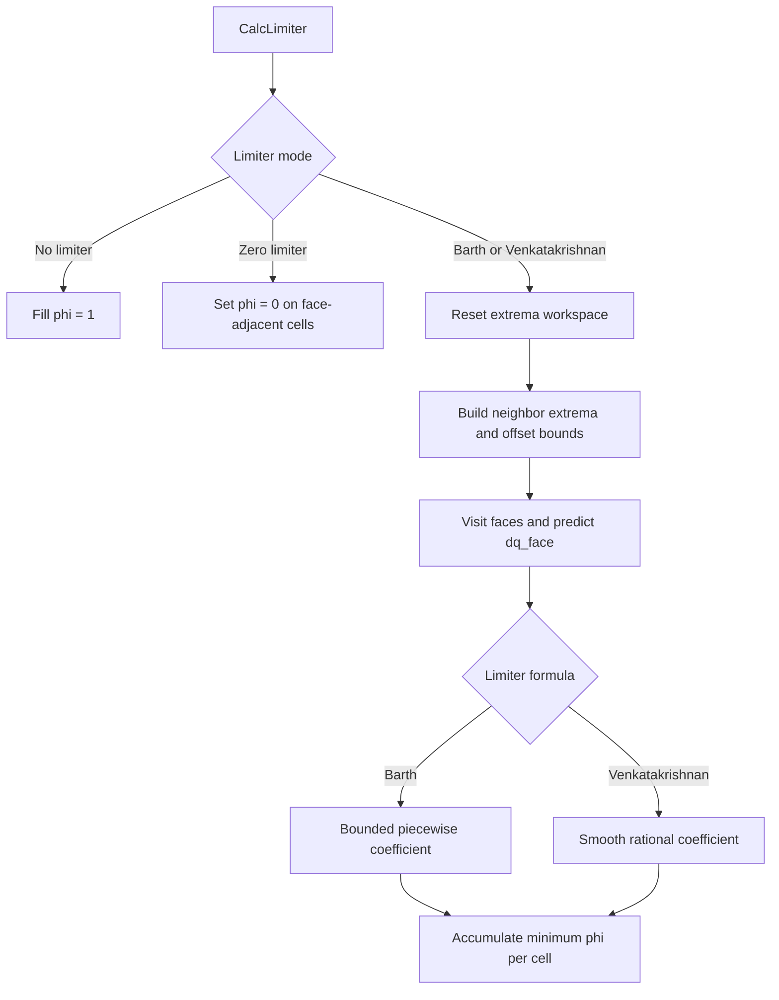

# Field Extents and Face-Limiter Reconstruction

## Scope

This note records the size-type contract behind the `MRField` face-state buffers and the workspace lifecycle in the finite-volume reconstruction path. The changes are intentionally narrow: they align the `Marray` constructor extents with `HXSize_t` and reuse limiter extrema storage without changing the limiter formulas or their initialization semantics.

## Numerical policy boundary

The scalar Barth and Venkatakrishnan functions are numerical policies: they map a predicted
face increment and local allowable range to a limiter coefficient. They do not need mesh
connectivity, cell fields, solver state, or face traversal to define that mapping.

These functions now live in `ULimiterPolicy.h/.cpp`, separate from `ULimiter.cpp`, which
owns mesh traversal, per-cell extrema, and application of coefficients to the runtime fields.
This is a deliberately small boundary, not a redesign of the full limiter pipeline.

The focused `limiter_policy_test` pins representative policy behavior:

- Barth returns zero for a face direction that conflicts with the expected direction.
- Barth limits positive and negative increments that exceed their permitted bounds.
- Barth leaves an increment unchanged when it is inside the permitted range.
- Venkatakrishnan selects the upper or lower bound according to the increment sign and
  returns one for a near-zero increment.

These tests do not prove the full finite-volume reconstruction is correct. Mesh-neighbor
range construction, interface ghost values, face geometry, equation-level positivity checks,
and numerical convergence still require integration and CFD regression evidence.

## Formula variants and regression scope

The policy API exposes two rational forms, and their names should not be read as interchangeable:

- `Vencat` uses a cross-term coefficient of 2 in the numerator and 1 in the denominator.
- `VencatEric` uses a cross-term coefficient of 1 in both places, while retaining the coefficient 2 on the squared increment in the denominator.

The active `CalcVencatLimiter` path calls `VencatFunction`, which dispatches to `Vencat`. The alternate `VencatFunctionEric` remains a separate callable policy; this refactor does not switch the production algorithm to it. Focused tests pin both the active formula and the alternate formula so a future cleanup cannot silently conflate them.

These tests verify formula selection and sign-dependent bound selection, not that either variant is universally preferable for every flow. Any change to the production variant or regularization scale should be reviewed as a numerical-method change and validated with representative CFD regressions, not only scalar unit tests.

## Storage contract

`HXSize_t` is the unsigned size/count type used by OneFLOW and aliases `std::size_t`. `MRField` is an alias for `Marray<Real>`, whose storage is a vector of equation fields:

- The outer extent is the number of equations (`nEqu`).
- Each inner extent is the number of values stored for one equation (`nValues`); the values may represent cells, faces, or another domain-specific collection. The generic container should not assume that every inner extent is a cell count.
- For face-state buffers, the inner extent is the number of faces.

The `Marray` constructor previously accepted `HXSize_t` for the equation count but `int` for the inner extent. Passing a face count from `HXSize_t` therefore narrowed a size value to `int`, producing MSVC warning C4267 at the `std::make_unique<MRField>` call in `ULimiter.cpp`. The constructor now uses `HXSize_t` for both extents, matching the vector size API and avoiding a call-site cast that would merely conceal the mismatch. Its second parameter is named `nValues` rather than `numberOfCells`, because `Marray` is a generic equation-by-value container and also stores face data. This is a naming clarification, not a storage-layout change.

This is an interface-contract fix, not a claim that every index in the array subsystem has already been migrated. Index types and legacy loops can be reviewed separately when a concrete boundary or warning warrants it.

## Regression test

`tests/basic/MarrayTest.cpp` constructs an `Marray` using `HXSize_t` variables for both dimensions and checks the resulting equation count and per-equation value count. This makes the extent contract executable and puts the test in CTest through the `MarrayTest` target. It is intentionally a small contract test: it does not allocate extreme sizes or attempt to test allocator failure.

## Face-state buffer lifecycle

`LimField::BindFieldsAndAllocFaces` binds the cell-centered solution and gradient fields, then determines the equation count from the solution field. It retains `qf1` and `qf2` while both equation and face extents still match. If either buffer is absent or its extent differs, both are recreated with the required shape.

That reuse is important because the limiter is initialized repeatedly during Runge-Kutta stages. The face buffers are scratch storage, not persistent physical state: `GetQlQr` initializes face values from the adjacent left and right cells, reconstruction updates them, and boundary handling adjusts boundary-face values. Preserving the extent check avoids unnecessary allocation while keeping the shape tied to the current grid and equation system.

## Limiter extrema workspace lifecycle

`Limiter::CalcLimiter` computes extrema for each equation before evaluating Barth or Venkatakrishnan coefficients. Previously, it constructed `minvf` and `maxvf` at every call and destroyed them after processing all equations. The arrays are scratch workspace: their values are rebuilt for the next limiter calculation, so their storage can persist even though their contents cannot.

The implementation now keeps these two vectors in the existing RAII-owned `Lim` object. Before each calculation, `assign(ug.nTCell, 0.0)` resets every entry and adjusts the logical extent to the current grid. When the grid size is unchanged, the vector can retain its allocated capacity and avoid repeated heap allocation. If the extent changes, the vector interface still accommodates the new size.

The full reset is deliberate. `BuildNeighborRangeOffsets` seeds extrema from physical cells and then updates them through interface and interior faces. Other slots, including ghost-cell slots, were previously zero-initialized by constructing a fresh vector. Reusing old contents without clearing them would change those slots and could alter boundary-face limiter inputs. This change preserves the existing zero-initialization behavior rather than attempting to reinterpret or repair the ghost-cell algorithm.

This is a workspace-lifetime optimization, not a numerical-method change. It removes repeated allocation/deallocation while retaining the same initial values for the extrema arrays on every call. A future numerical change to ghost extrema should be handled separately, with boundary/interface tests and solver regression evidence.

## Reconstruction algorithm overview

For each face, the method uses the left and right adjacent cells and the face-center displacement from each cell center. For a cell-side state, the linear reconstruction has the form

`q_face = q_cell + phi * (grad(q)_cell dot (x_face - x_cell))`

where `phi` is the cell limiter coefficient (or the minimum of the two side coefficients when the configured face reconstruction requires a shared limiter). A state-check callback accepts the candidate; when it rejects the candidate, the unmodified face value is retained. The weighted variant can blend the left and right states when a reconstructed candidate fails the check.

The limiter coefficient is computed from local neighbor extrema. The Barth limiter constrains extrapolation so the face prediction does not exceed the local allowable difference; the Venkatakrishnan variant applies a smooth limiter function with an epsilon related to the local solution range. Interface boundary faces are handled explicitly when building neighbor extrema, while ordinary interior faces update extrema for both adjacent cells.

## Neighbor-range construction contract

`Limiter::BuildNeighborRangeOffsets()` relies on the grid's face ordering and cell indexing; these are algorithm inputs, not incidental loop details.

1. The first `nCells` entries are physical cells. Their extrema are seeded from their own `q` values.
2. Boundary faces occupy `[0, nBFaces)`. Only interface boundary faces contribute a remote value to the local cell's extrema. The loop updates `lc`, not both `lc` and `rc`; the boundary-face connectivity must therefore keep the local physical cell on the left side for this operation.
3. Ordinary interior faces occupy `[nBFaces, nFaces)`. Each such face contributes the opposite cell value to both adjacent cells.
4. Only the physical-cell extrema are converted to offsets by subtracting the cell's own value. The reduction into `minOffsetRange` and `maxOffsetRange` also visits physical cells only.

The workspace has `nTCell` entries, but the range algorithm does not initialize ghost extrema from ghost-cell values. Their zero state is preserved through the offset conversion and they may still be read as the opposite-side value on an interface face. This behavior is part of the current algorithm's boundary contract; it should not be changed as a side effect of workspace reuse or loop consolidation.

The main invariant is that `minvf[c]` and `maxvf[c]` are offset bounds for each physical cell after the final conversion, while `minOffsetRange/maxOffsetRange` summarize those offsets across physical cells. They are not absolute solution minima and maxima. The current method is intentionally kept beside limiter traversal until its mesh inputs are independently testable. If it is extracted later, the stable boundary should accept face connectivity and interface classification explicitly, with tests for interface orientation and the physical/ghost distinction. The name `BuildNeighborRangeOffsets` emphasizes that the output is per-cell offset bounds, not absolute minima and maxima.

## Limiter mode dispatch and neighbor-range algorithm

### Execution map

The code path can be read as three responsibilities: construct neighbor ranges, evaluate a face-side limiter, then accumulate the most restrictive coefficient into each cell. The no-limiter policy exits before this pipeline.

### Mathematical meaning

For a cell-centered scalar $q_i$, the linear reconstruction to face center $f$ is

\[
q_{i,f}=q_i+\phi_i\,\nabla q_i\cdot(\mathbf{x}_f-\mathbf{x}_i),
\qquad
\Delta q_{i,f}=\nabla q_i\cdot(\mathbf{x}_f-\mathbf{x}_i).
\]

The range-building pass starts with the cell's own value and includes neighboring values. It then stores differences relative to the cell value. In the notation below, $m_i$ and $M_i$ are therefore *offset bounds*, not absolute solution extrema:

\[
m_i=\min_{j\in N(i)}(q_j-q_i),\qquad
M_i=\max_{j\in N(i)}(q_j-q_i).
\]

The implementation constructs these bounds through face connectivity, with a separate pass for interface boundary faces so the physical cell sees its exchanged neighbor. Ordinary boundary-face ghost values are not treated as ordinary interior neighbors by this range-building pass.

For the Barth branch, the source implements the following piecewise rule for each face side. The directional check is represented by $d_i$; a negative value forces zero:

\[
\phi_{i,f}=
\begin{cases}
0, & d_i<0,\\
M_i/\Delta q_{i,f}, & \Delta q_{i,f}>M_i,\\
m_i/\Delta q_{i,f}, & \Delta q_{i,f}<m_i,\\
1, & \text{otherwise}.
\end{cases}
\]

The cell coefficient is reduced over faces by taking the minimum of its current value and the new face-side coefficient. This is why the face loops can update both adjacent cells while the limiter remains cell-centered.

For the Venkatakrishnan branch, the source chooses the upper offset when $\Delta q_{i,f}>0$ and the lower offset when $\Delta q_{i,f}<0$. With $x$ as that selected bound and $y=\Delta q_{i,f}$, the current implementation uses

\[
V(x,y,\epsilon)=
\frac{x^2+\epsilon+2xy}
{x^2+2y^2+xy+\epsilon}.
\]

The regularization scale is computed by the pure `VencatRegularizationEpsilon` policy, separate from face traversal:

\[
\epsilon = \left(c\,\max(M_{\mathrm{global}}-m_{\mathrm{global}},1)\right)^2+\texttt{SMALL},
\]

where $c$ is the configured `vencat_coef`, and $m_{\mathrm{global}}$ / $M_{\mathrm{global}}$ are the global extrema of the per-cell offset bounds. The helper accepts only those scalar inputs and returns the squared regularization term consumed by `VencatFunction`. Focused tests pin both the unit-floor case and a range larger than one; the mesh-dependent construction of those global bounds remains in `BuildNeighborRangeOffsets`. `CalcVencatLimiter` computes this term once after building the range and reuses it for every face of the current equation. The range is unchanged throughout that face loop, so recalculating the same scalar expression in `CalcLocalVencatLimiter` for every face was redundant. This moves invariant work out of the hot loop without changing the formula or its inputs. When the predicted increment is sufficiently close to zero (abs(dq) <= SMALL), the function returns one instead of evaluating a sign-dependent bound.

These equations are a reading aid for the current implementation, not a claim that every published variant uses identical constants or regularization. In particular, Vencat currently sets the cross-term coefficient to 2.0; VencatEric is a separate variant and is not the function selected by CalcVencatLimiter.

The no-limiter policy is handled at the top of `Limiter::CalcLimiter`: it fills the complete limiter field with one and may skip later fills only when the interface-exchange policy says that the field is not overwritten there. `CalcLimiterScalar` also returns immediately for this mode. Therefore, a second face-traversal implementation that writes one to both cells of every face is unreachable and redundant; it has been removed so the dispatch reflects the actual execution path.

For Barth and Venkatakrishnan modes, `BuildNeighborRangeOffsets` follows a two-stage range construction:

1. Initialize each physical cell's lower and upper value to its own solution value.
2. For interface boundary faces, include the opposite-side value in the local physical cell's range. For interior faces, update both adjacent cells with the other cell's value.
3. Convert the extrema to offsets from the cell value by subtracting the cell-centered solution. The resulting bounds are the allowed negative and positive reconstruction increments, not absolute solution values.
4. Reduce these offsets over physical cells to obtain `minOffsetRange` and `maxOffsetRange`; the Venkatakrishnan epsilon is scaled from this range and the configured coefficient.

For a face and cell side, the gradient predicts an increment `dqFace = grad(q) dot (xFace - xCell)`. Barth compares this increment with the local offset bounds and returns a coefficient in the range required to prevent the extrapolation from exceeding those bounds; its face-normal direction check can force the coefficient to zero. Venkatakrishnan instead evaluates a smooth rational limiter function using the predicted increment, the appropriate local bound, and epsilon. Both methods accumulate the most restrictive face-side coefficient into the cell's limiter field.

This separation helps explain why the storage refactor is deliberately conservative: the extrema vectors are temporary storage for a well-defined algorithmic pipeline. Reusing their capacity is safe only while the per-call range initialization and the distinction between physical cells, interface ghosts, and ordinary boundary faces remain unchanged.

## Architectural significance

The change clarifies a responsibility boundary:

1. Grid and field owners express counts using the shared size type.
2. The generic array container accepts those extents without narrowing.
3. The limiter owns its extrema workspace and controls when its capacity can be reused; contents are reset at every calculation.
4. No-limiter dispatch is an explicit fast path; Barth and Venkatakrishnan share neighbor-range construction but retain distinct coefficient formulas.
5. Numerical reconstruction and limiter policy remain independent of the storage-type correction.

The goal is not to redesign the limiter or migrate every legacy index in one pass. It is to remove a real type mismatch at the reusable container boundary and reduce repeated workspace allocation while preserving the numerical formulas and per-call initialization semantics.

## Validation checklist

- Build the affected solver targets with MSVC and confirm C4267 is gone from the `Marray` construction path.
- Confirm the new `MarrayTest` is discovered by CTest and passes.
- Run the full configured test suite.
- Run the relevant CFD regression cases and compare numerical outputs if the build changes any template instantiations beyond the intended signature adjustment.
- Confirm `qf1` and `qf2` are still reused when equation and face extents match and reallocated when either extent changes.
- Confirm `minvf` and `maxvf` are reused across limiter calls, reset to zero over the full `nTCell` extent each time, and resize correctly when the grid extent changes.

 
## Independently tested neighbor-range construction

The face-connectivity portion now lives in `ULimiterRange.h` as
`BuildCellNeighborOffsetBounds`. The solver adapter in `ULimiter.cpp` supplies
the current equation field, left/right face-cell maps, boundary types, physical
cell count, face partition, and the existing `BC::IsInterfaceBc` classifier.
The helper does not depend on `UnsGrid`, solver globals, or limiter state, so a
small synthetic topology can exercise the algorithm without initializing a CFD case.

This boundary is intentionally narrower than a mesh abstraction: it extracts the
range-building algorithm that Barth and Venkatakrishnan already share, while the
solver remains responsible for the grid's interface-boundary classification and
workspace lifetime. The predicate is a template parameter so the interface check
can be inlined in production rather than adding an indirect callback to the face
loop.

The new `limiter_range_test` pins three topology semantics:

- An interface boundary face contributes its remote value to the local physical
  cell on the left.
- An ordinary interior face contributes each adjacent cell's value to the other
  cell's range.
- Ghost slots are not converted to offsets or included in the global offset-range
  reduction; the caller clears them before each calculation, matching the existing
  workspace lifecycle.

The extracted helper intentionally does not resize or clear its output arrays.
That remains the caller's responsibility, keeping allocation and scratch-state
lifetime outside the numerical range algorithm. This also preserves the current
zeroed ghost-slot behavior instead of silently changing boundary semantics during
the extraction.

## Marray index type contract

The two extents and the equation-indexing interface now use `HXSize_t`. This keeps the generic container's size and index vocabulary aligned with the underlying `HXVector` storage and avoids narrowing an equation index to `int` at the wrapper boundary. Existing callers with `int` indices remain source-compatible through the ordinary integral conversion, but callers that already use `HXSize_t` no longer need to pass through an unnecessarily narrower parameter type.

This is a local interface correction, not a repository-wide index migration. It does not change storage layout, bounds-checking behavior, or the numerical algorithms that use `Marray`. The constructor extent regression test remains the first executable contract; the full Windows build and CTest suite should be run after this interface adjustment to catch any overload or warning interactions.

## Validation boundary for Marray indexing

The index contract test uses `decltype` with `std::declval` to check the expression result types directly: mutable access must return `HXVector<T>&`, while const access must return `const HXVector<T>&`. A runtime test also writes through mutable access and reads the same value through a const reference. These checks protect both the parameter-type contract and the existing const-correct reference semantics.

This does not add bounds checking: `Marray::operator[]` continues to follow the unchecked indexing behavior of its underlying vector. Changing that behavior would be a separate API and performance decision, not an incidental consequence of aligning size types.

Other legacy allocation helpers, including the `int` dimensions in `HXVector.h`'s `AllocateVector`, are intentionally not changed by this patch. Before widening those interfaces, inventory their call sites and determine whether the arguments represent general container extents or domain-specific bounded indices. The shared spelling of an integer type is not, by itself, sufficient evidence that two interfaces have the same contract.

## Generic container behavior versus structured-grid allocation

The Marray scalar assignment operator fills each equation's inner vector; it does not resize the outer or inner extents. Its contract is therefore "fill existing shape", not "allocate or resize". The regression test checks every element of a two-equation, three-value array so a future implementation change cannot accidentally fill only one equation or silently alter shape semantics.

The similarly named AllocateVector helpers in HXVector.h are a different layer. Their current dimensions are signed int, and representative callers include structured-grid coordinate arrays (Block2D, Block3D, SDomain) as well as chemistry coefficient tables. This is not enough evidence to replace those parameters mechanically with HXSize_t: signed dimensions can represent invalid negative input, and converting such a value to an unsigned extent before validation can turn it into a very large allocation request. The helpers also have inconsistent handling of non-positive dimensions between the 2D and 3D overloads. A future cleanup should first define the intended behavior for invalid dimensions, then add tests for that behavior, and only then choose a shared extent type or validation adapter.

The architectural distinction is the important result: Marray accepts already-defined container extents, while AllocateVector is a legacy allocation helper that also interprets caller-provided structured-grid dimensions. The two APIs should not be unified merely because both ultimately call vector::resize.
