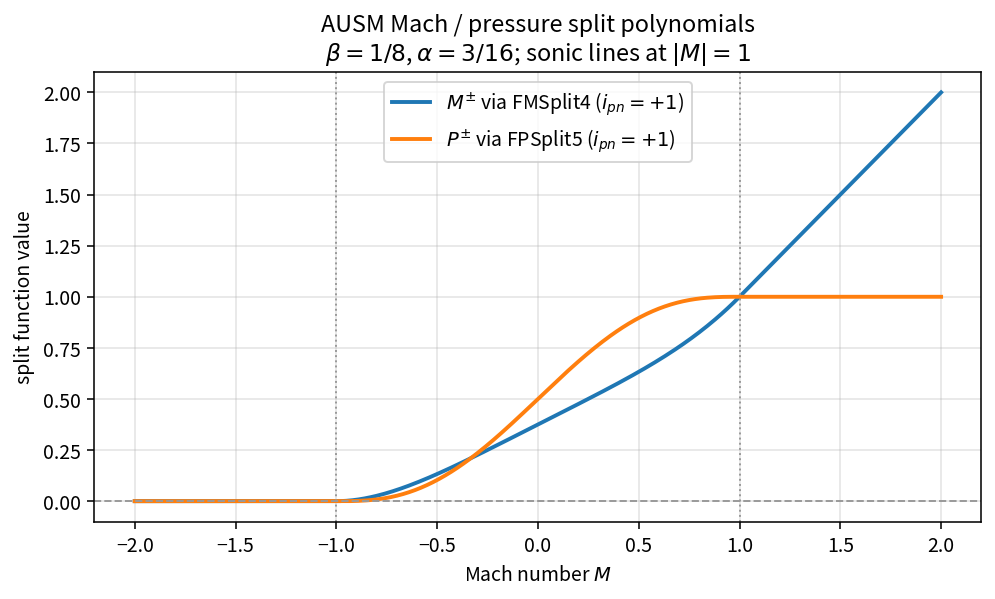

AUSM Mach and pressure split polynomials
=======================================

Purpose
-------

AUSM-family fluxes split the convective mass flux and pressure using smooth
functions of the face Mach number. OneFLOW exposes the production polynomials
as pure inline APIs in ``NsInvFluxPolicy.h``.

Formulas
--------

With interface sign :math:`i_{pn}=\pm 1`, :math:`\beta=1/8`, :math:`\alpha=3/16`:

.. math::

   M^{\pm}_1 = \tfrac12\bigl(M + i_{pn}|M|\bigr),\qquad
   M^{\pm}_2 = i_{pn}\tfrac14(M+i_{pn})^2

.. math::

   M^{\pm}_4 =
   \begin{cases}
   M^{\pm}_1 & |M|\ge 1 \\
   M^{\pm}_2\bigl(1 - i_{pn}\,16\,\beta\, M^{\mp}_2\bigr) & |M|< 1
   \end{cases}

.. math::

   P^{\pm}_5 =
   \begin{cases}
   \tfrac12\bigl(1 + i_{pn} M/|M|\bigr) & |M|\ge 1 \\
   M^{\pm}_2\bigl((2 i_{pn}-M) - i_{pn}\,16\,\alpha\, M\, M^{\mp}_2\bigr) & |M|< 1
   \end{cases}

Source map
----------

* Header: ``codes/ns/include/NsInvFluxPolicy.h`` (``FMSplit1/2/4``, ``FPSplit5``)
* Tests: ``tests/solver/inv_flux_policy_test.cpp``
  (``FMSplit4MachCurveMatchesClosedForm``, ``FPSplit5MachCurveMatchesClosedForm``)
* Theory table: ``tools/verification/data/ausm_mach_split_theory.csv``
* Contract Workbench id: ``ausm_mach_split``

What this proves / does not prove
---------------------------------

**Proves:** closed-form agreement of the pure split polynomials on a Mach grid.

**Does not prove:** assembled AUSM face flux, entropy fixes, or experimental
shock-capturing quality.
