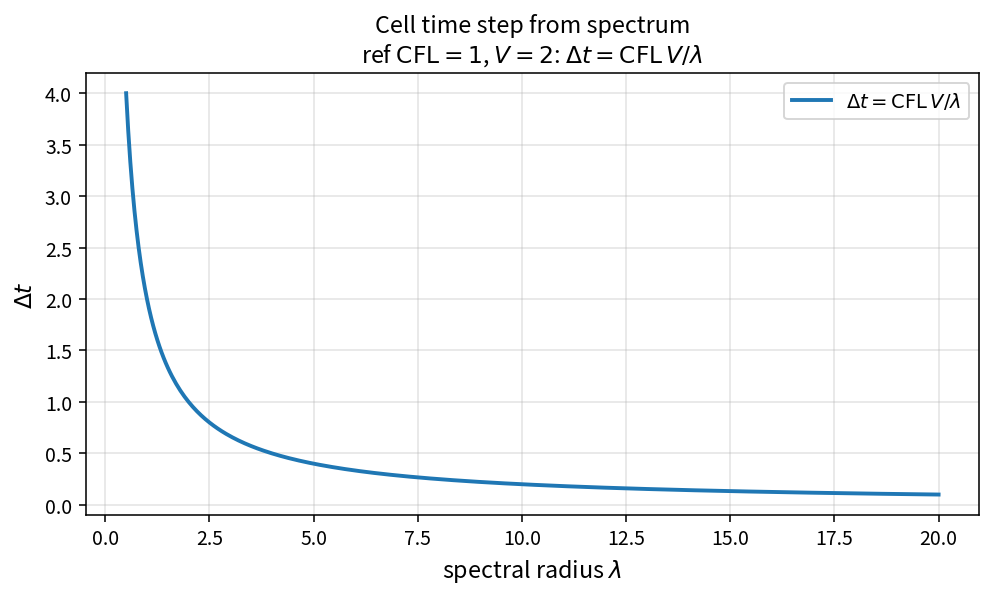

Cell time step from spectrum
============================

Purpose
-------

Convert a cell spectral radius estimate into a CFL-limited local time step.

Formula
-------

.. math::

   \Delta t = \frac{\mathrm{CFL}\,V}{\lambda}

Source map
----------

* ``CellTimeStepFromSpectrum`` in ``TimeStepPolicy``
* Upstream: inviscid/viscous spectral radii
* Downstream: ``CombineInvAndVisTimeStep``
* Tests: ``tests/solver/timestep_policy_test.cpp``
* Theory table: ``tools/verification/data/cell_time_step_from_spectrum_theory.csv``
* Contract Workbench id: ``cell_time_step_from_spectrum``

What this proves / does not prove
---------------------------------

**Proves:** \(\Delta t=\mathrm{CFL}\,V/\lambda\) and inverse-\(\lambda\) /
linear-\(V\) scaling match the pure API.

**Does not prove:** case-optimal CFL or spectrum model accuracy.

References
----------

* Standard finite-volume CFL / local time-step practice.
* Blazek time-step chapters; family: :doc:`viscous_spectral_radius`,
  :doc:`combine_inv_vis_timestep`.
