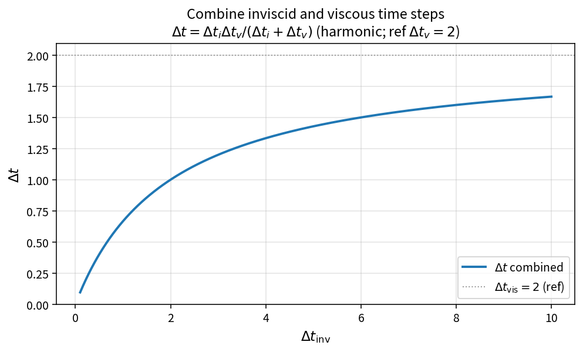

Combine inviscid and viscous time steps
=======================================

Purpose
-------

After separate inviscid and viscous local time-step estimates are formed from
spectral radii, OneFLOW combines them with a harmonic-type formula so that
the stiffer (smaller) limit dominates.

Formula
-------

.. math::

   \Delta t
   =\frac{\Delta t_{\mathrm{inv}}\,\Delta t_{\mathrm{vis}}}
         {\Delta t_{\mathrm{inv}}+\Delta t_{\mathrm{vis}}}

When \(\Delta t_{\mathrm{inv}}=\Delta t_{\mathrm{vis}}=\tau\), one obtains
\(\Delta t=\tau/2\).

Source map
----------

* ``CombineInvAndVisTimeStep`` in ``TimeStepPolicy``
* Upstream: ``CellTimeStepFromSpectrum`` on inviscid/viscous spectra
* Tests: ``tests/solver/timestep_policy_test.cpp``
* Theory table: ``tools/verification/data/combine_inv_vis_timestep_theory.csv``
* Contract Workbench id: ``combine_inv_vis_timestep``

What this proves / does not prove
---------------------------------

**Proves:** combine algebra matches the pure API on a sample grid.

**Does not prove:** correctness of the upstream spectra or case CFL limits.

References
----------

* Standard local time-step practice in compressible FV codes (min or harmonic
  of convective and viscous limits).
* Blazek time-step chapters (motivation for including viscous spectral radii).
* Family spectra: :doc:`viscous_spectral_radius`.
