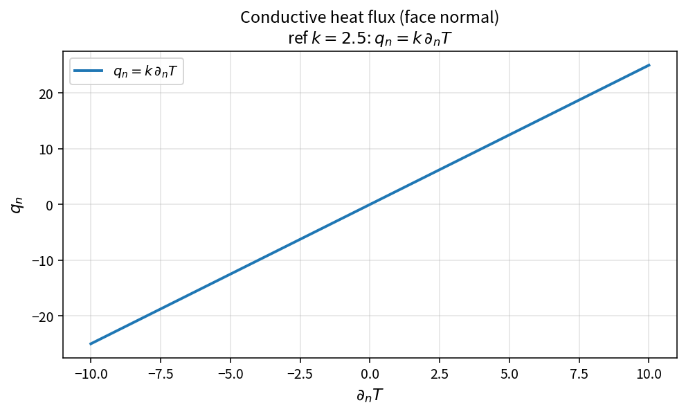

Conductive heat flux (face normal)
==================================

Purpose
-------

The conductive contribution to the viscous energy flux is Fourier heat
transfer through the face.

Formula
-------

.. math::

   q_n = k\,\partial_n T

with \(k=k_{\mathrm{eff}}\) from ``EffectiveThermalConductivity``.

Source map
----------

* ``ConductiveHeatFluxNormal`` in ``NsVisFluxPolicy``
* Upstream: ``EffectiveThermalConductivity``
* Downstream: ``ViscousEnergyFlux``
* Tests: ``tests/solver/vis_flux_policy_test.cpp``
* Theory table: ``tools/verification/data/conductive_heat_flux_normal_theory.csv``
* Contract Workbench id: ``conductive_heat_flux_normal``

What this proves / does not prove
---------------------------------

**Proves:** \(q_n=k\partial_n T\) matches the pure API on a gradient grid.

**Does not prove:** wall heat-transfer accuracy or turbulence \(Pr_t\) modeling.

References
----------

* Fourier heat conduction in compressible NS energy equation.
* Related: :doc:`effective_thermal_conductivity`, :doc:`viscous_energy_flux`
  (when present).
