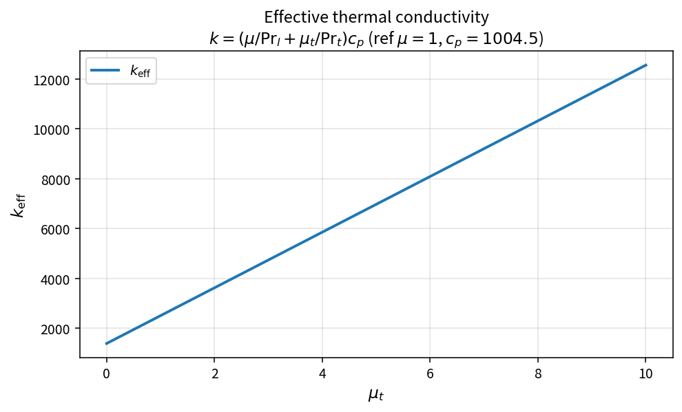

Effective thermal conductivity
==============================

Purpose
-------

For eddy-viscosity RANS, the conductive heat flux uses an effective
conductivity that combines laminar and turbulent contributions.

Formula
-------

.. math::

   k_{\mathrm{eff}}
   =\left(\frac{\mu}{\mathrm{Pr}_l}+\frac{\mu_t}{\mathrm{Pr}_t}\right)c_p

OneFLOW stores inverse Prandtl numbers, so

.. math::

   k_{\mathrm{eff}}=(\mu\cdot\mathrm{invPr}_l+\mu_t\cdot\mathrm{invPr}_t)\,c_p

Source map
----------

* ``EffectiveThermalConductivity`` in ``NsVisFluxPolicy``
* Downstream: ``ConductiveHeatFluxNormal``
* Tests: ``tests/solver/vis_flux_policy_test.cpp``
* Theory table: ``tools/verification/data/effective_thermal_conductivity_theory.csv``
* Contract Workbench id: ``effective_thermal_conductivity``

What this proves / does not prove
---------------------------------

**Proves:** conductivity algebra matches the pure API on a \(\mu_t\) grid.

**Does not prove:** full viscous energy flux residual or wall heat-transfer
accuracy on a case.

References
----------

* Standard RANS gradient-diffusion heat flux (turbulent Prandtl number).
* Related viscous spectral energy channel in Blazek-style estimates uses the
  same \(\mu/\mathrm{Pr}\) combination (see :doc:`viscous_spectral_radius`).
