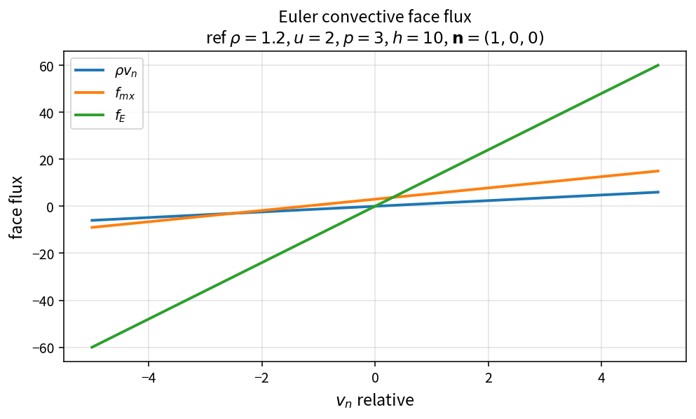

Euler convective face flux
==========================

Purpose
-------

Evaluate the inviscid (Euler) face flux for a given relative normal velocity
and thermodynamic state.

Formula
-------

.. math::

   \mathbf{F}^c
   =\rho v_n
   \begin{bmatrix}
   1 \\ \mathbf{u} \\ H
   \end{bmatrix}
   +
   p
   \begin{bmatrix}
   0 \\ \mathbf{n} \\ v_g
   \end{bmatrix}

Source map
----------

* ``EulerConvectiveFlux`` in ``NsInvFluxPolicy``
* Upstream: ``RelativeFaceNormalVelocity``, total enthalpy
* Tests: ``tests/solver/inv_flux_policy_test.cpp``
* Theory table: ``tools/verification/data/euler_convective_flux_theory.csv``
* Contract Workbench id: ``euler_convective_flux``

What this proves / does not prove
---------------------------------

**Proves:** Euler face flux algebra matches the pure API on a \(v_n\) grid.

**Does not prove:** Riemann solver (Roe/AUSM) residual quality on a case.

References
----------

* Standard finite-volume Euler flux; Blazek CFD.
* Related: :doc:`relative_face_normal_velocity`, :doc:`face_mach_number`.
