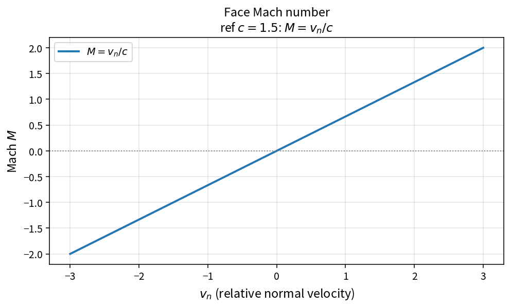

Face Mach number
================

Purpose
-------

The relative face Mach number is the ratio of relative normal velocity to
local sound speed. It drives AUSM-type mass and pressure split functions.

Formula
-------

.. math::

   M = \frac{v_n}{c}

Source map
----------

* ``FaceMachNumber`` in ``NsInvFluxPolicy``
* Consumers: AUSM paths in ``NsInvFlux``
* Tests: ``tests/solver/inv_flux_policy_test.cpp``
* Theory table: ``tools/verification/data/face_mach_number_theory.csv``
* Contract Workbench id: ``face_mach_number``

What this proves / does not prove
---------------------------------

**Proves:** \(M=v_n/c\) matches the pure API on a velocity grid.

**Does not prove:** AUSM flux accuracy or full inviscid residual.

References
----------

* Liou, AUSM-family schemes (face Mach as primary interface quantity).
* Related: :doc:`ausm_mach_split` (when present),
  :doc:`ideal_gas_sound_speed_from_pressure`.
