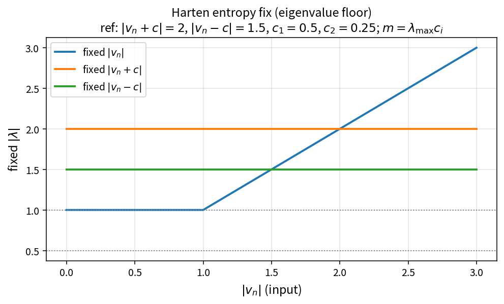

Harten entropy fix (Roe eigenvalue floor)
=========================================

Purpose
-------

Near sonic points, Roe absolute eigenvalues can become too small and allow
expansion shocks. A Harten-type fix floors selected wave speeds using fractions
of the largest face eigenvalue.

Formula (OneFLOW pure policy)
-----------------------------

With absolute inputs :math:`a_1=|v_n|`, :math:`a_2=|v_n+c|`, :math:`a_3=|v_n-c|`
and coefficients :math:`c_1`, :math:`c_2`:

.. math::

   \lambda_{\max}=\max(a_2,a_3),\quad
   m_1=\lambda_{\max} c_1,\quad
   m_2=\lambda_{\max} c_2

.. math::

   a_1\leftarrow\max(m_1,a_1),\quad
   a_2\leftarrow\max(m_2,a_2),\quad
   a_3\leftarrow\max(m_2,a_3)

when the fix is enabled; otherwise inputs are unchanged.

Source map
----------

* ``ApplyHartenEntropyFix`` in ``codes/ns/include/NsInvFluxPolicy.h``
* Tests: ``tests/solver/inv_flux_policy_test.cpp``
* Theory table: ``tools/verification/data/harten_entropy_fix_theory.csv``
* Contract Workbench id: ``ns_roe_harten``

What this proves / does not prove
---------------------------------

**Proves:** pure floor algebra matches production ``MAX`` semantics on a sample grid.

**Does not prove:** full Roe flux shock-capturing quality or case residuals.
