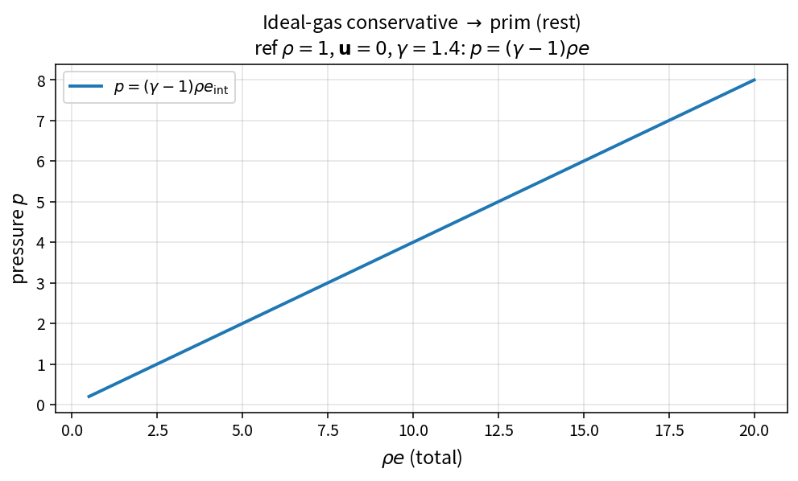

Ideal-gas conservative to prim
==============================

Purpose
-------

Recover primitive variables from conserved density, momentum and total
energy for a calorically perfect gas.

Formula
-------

.. math::

   \rho = |q_{\rho}|,\qquad
   \mathbf{u}=\frac{\mathbf{q}_{\rho u}}{\rho},\qquad
   p=(\gamma-1)\bigl(q_{\rho e}-\tfrac12\rho|u|^{2}\bigr)

Source map
----------

* ``IdealGasConservativeToPrim`` in ``NsInvFluxPolicy``
* Inverse of ``IdealGasPrimToConservative``
* Tests: ``tests/solver/inv_flux_policy_test.cpp``
* Theory table: ``tools/verification/data/ideal_gas_conservative_to_prim_theory.csv``
* Contract Workbench id: ``ideal_gas_conservative_to_prim``

What this proves / does not prove
---------------------------------

**Proves:** rest-gas pressure and kinetic subtraction match the pure API.

**Does not prove:** positivity preservation near vacuum.

References
----------

* Standard ideal-gas finite-volume variable conversion.
* Related: :doc:`ideal_gas_prim_to_conservative`.
