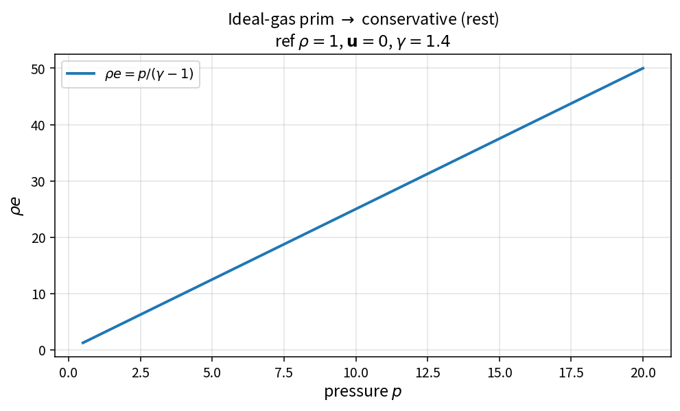

Ideal-gas prim to conservative
==============================

Purpose
-------

Convert primitive variables \((\rho,\mathbf{u},p)\) to conserved
\((\rho,\rho\mathbf{u},\rho e)\) for the calorically perfect gas.

Formula
-------

.. math::

   \mathbf{q}
   =
   \begin{bmatrix}
   \rho \\
   \rho\mathbf{u} \\
   \rho\left(\dfrac{p}{\rho(\gamma-1)}+\dfrac12|u|^{2}\right)
   \end{bmatrix}

Source map
----------

* ``IdealGasPrimToConservative`` in ``NsInvFluxPolicy``
* Uses ``IdealGasSpecificInternalEnergy``
* Inverse: ``IdealGasConservativeToPrim``
* Tests: ``tests/solver/inv_flux_policy_test.cpp``
* Theory table: ``tools/verification/data/ideal_gas_prim_to_conservative_theory.csv``
* Contract Workbench id: ``ideal_gas_prim_to_conservative``

What this proves / does not prove
---------------------------------

**Proves:** rest-gas energy and kinetic samples match the pure API.

**Does not prove:** real-gas EOS or species transport.

References
----------

* Standard ideal-gas finite-volume variable conversion.
* Related: :doc:`ideal_gas_specific_internal_energy`.
