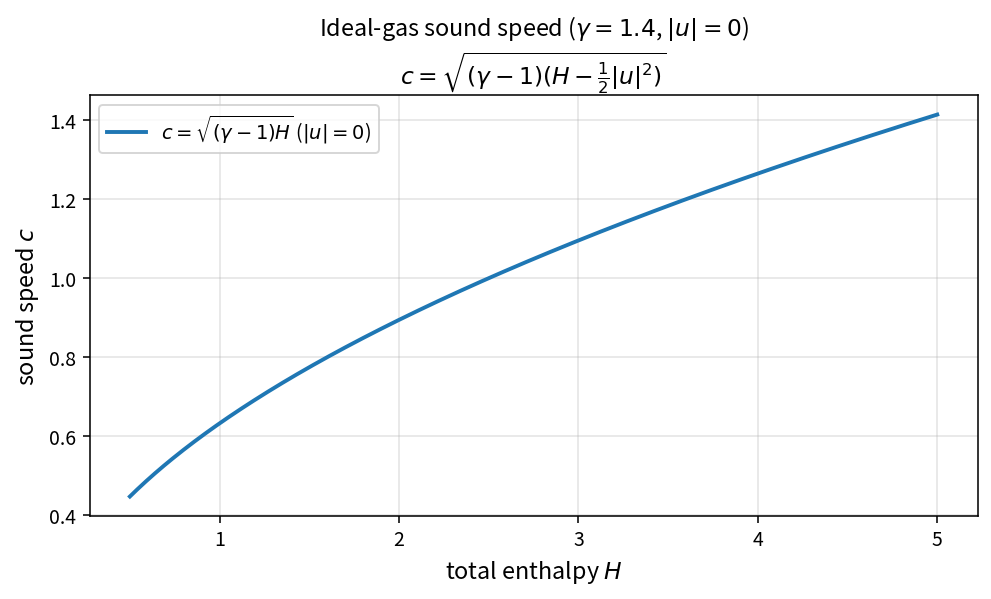

Ideal-gas sound speed
=====================

Purpose
-------

The isentropic sound speed used by Roe eigenvalues and spectral radii is
recovered from total enthalpy after removing kinetic energy.

Formula
-------

.. math::

   c = \sqrt{(\gamma-1)\left(H-\frac{1}{2}|u|^{2}\right)}

Source map
----------

* ``IdealGasSoundSpeed`` in ``NsInvFluxPolicy``
* Upstream: ``IdealGasStaticEnthalpy``, ``TotalEnthalpy``
* Downstream: ``RoeAbsoluteEigenvalues``, inviscid spectral radius
* Tests: ``tests/solver/inv_flux_policy_test.cpp``
* Theory table: ``tools/verification/data/ideal_gas_sound_speed_theory.csv``
* Contract Workbench id: ``ideal_gas_sound_speed``

What this proves / does not prove
---------------------------------

**Proves:** sound-speed algebra matches the pure API on sample states.

**Does not prove:** real-gas thermodynamics or assembled flux residual.
