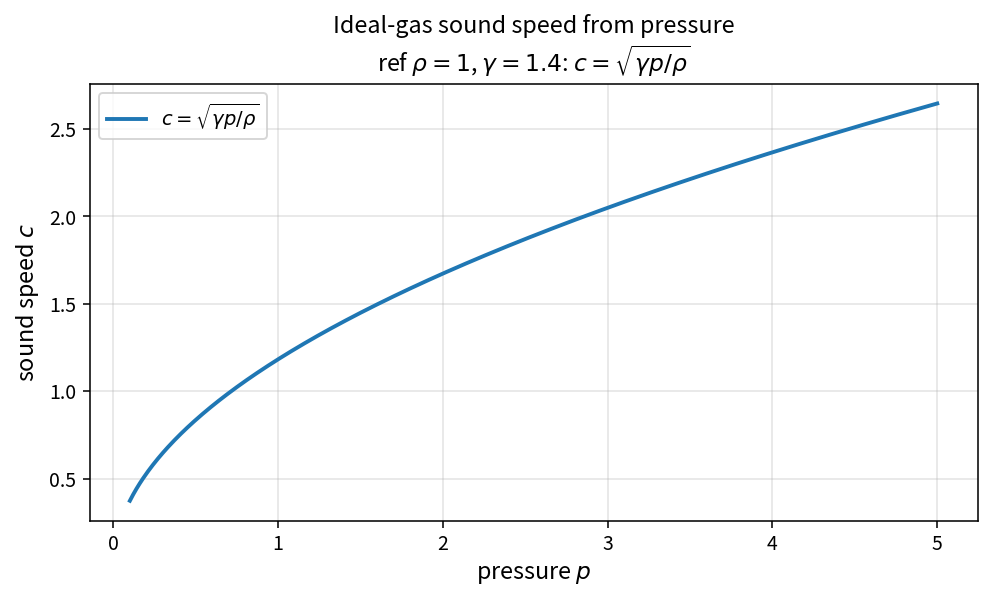

Ideal-gas sound speed from pressure
===================================

Purpose
-------

When static pressure and density are available, the isentropic sound speed
is evaluated directly without going through total enthalpy.

Formula
-------

.. math::

   c = \sqrt{\gamma\frac{p}{\rho}}

Relation to the total-enthalpy form
-----------------------------------

``IdealGasSoundSpeed`` uses

.. math::

   c = \sqrt{(\gamma-1)\bigl(H-\tfrac12|u|^{2}\bigr)}

which is equivalent for a calorically perfect gas when
\(H=h+\tfrac12|u|^{2}\) and \(h=\gamma p/((\gamma-1)\rho)\).

Source map
----------

* ``IdealGasSoundSpeedFromPressure`` in ``NsInvFluxPolicy``
* Related: ``IdealGasSoundSpeed``, ``RoeAbsoluteEigenvalues``
* Tests: ``tests/solver/inv_flux_policy_test.cpp``
* Theory table: ``tools/verification/data/ideal_gas_sound_speed_from_pressure_theory.csv``
* Contract Workbench id: ``ideal_gas_sound_speed_from_pressure``

What this proves / does not prove
---------------------------------

**Proves:** \(c=\sqrt{\gamma p/\rho}\) matches the pure API on a pressure grid.

**Does not prove:** numerical identity with the total-enthalpy form on every
Roe-averaged state (separate consistency tests).

References
----------

* Standard ideal-gas isentropic relation.
* Companion: :doc:`ideal_gas_sound_speed`.
