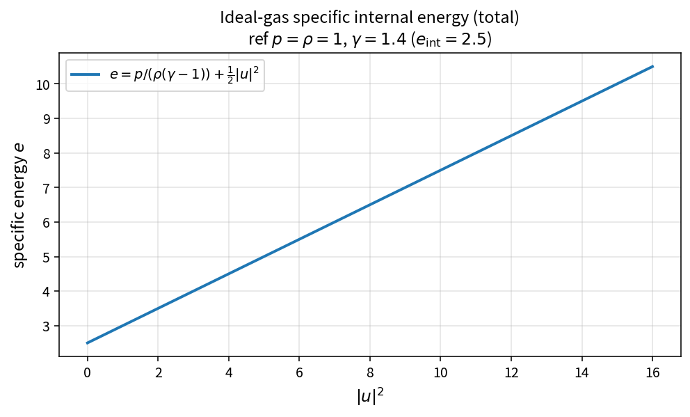

Ideal-gas specific internal energy
==================================

Purpose
-------

The calorically perfect gas maps pressure and density to thermal energy and
adds kinetic energy to form the specific total energy used by the
conservative update.

Formula
-------

.. math::

   e = \frac{p}{\rho(\gamma-1)} + \frac{1}{2}|u|^{2}

Source map
----------

* ``IdealGasSpecificInternalEnergy`` in ``NsInvFluxPolicy``
* Related: ``IdealGasStaticEnthalpy``, ``TotalEnthalpy``,
  ``IdealGasPrimToConservative``
* Tests: ``tests/solver/inv_flux_policy_test.cpp``
* Theory table: ``tools/verification/data/ideal_gas_specific_internal_energy_theory.csv``
* Contract Workbench id: ``ideal_gas_specific_internal_energy``

What this proves / does not prove
---------------------------------

**Proves:** energy algebra matches the pure API on a kinetic grid.

**Does not prove:** real-gas thermodynamics or assembled flux residual.

References
----------

* Standard ideal-gas caloric equation of state.
* Related EOS docs: :doc:`ideal_gas_static_enthalpy`, :doc:`total_enthalpy`.
