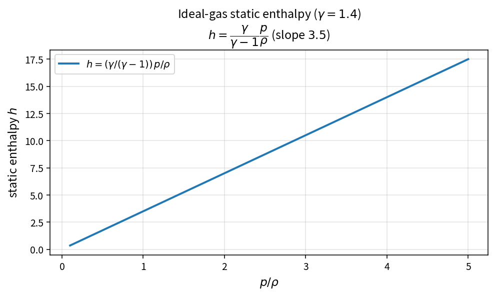

Ideal-gas static enthalpy
=========================

Purpose
-------

For a calorically perfect gas the static enthalpy is a linear function of
:math:`p/\rho`. OneFLOW isolates this as ``IdealGasStaticEnthalpy``.

Formula
-------

.. math::

   h = \frac{\gamma}{\gamma-1}\frac{p}{\rho}

With :math:`\gamma=1.4` the slope versus :math:`p/\rho` is :math:`3.5`.

Source map
----------

* ``IdealGasStaticEnthalpy`` in ``NsInvFluxPolicy``
* Related: ``IdealGasSpecificInternalEnergy``, ``TotalEnthalpy``, ``IdealGasSoundSpeed``
* Tests: ``tests/solver/inv_flux_policy_test.cpp``
* Theory table: ``tools/verification/data/ideal_gas_static_enthalpy_theory.csv``
* Contract Workbench id: ``ideal_gas_static_enthalpy``

What this proves / does not prove
---------------------------------

**Proves:** enthalpy algebra matches the pure API on a sample grid.

**Does not prove:** real-gas EOS or variable specific-heat models.
