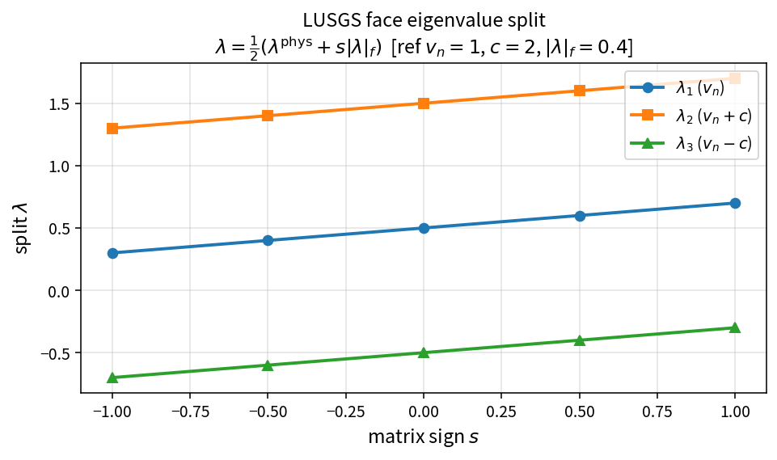

LUSGS face eigenvalue split
===========================

.. math::

   \lambda_1 = \frac12(v_n + s|\lambda|_{f,1}),\quad
   \lambda_2 = \frac12(v_n+c + s|\lambda|_{f,2}),\quad
   \lambda_3 = \frac12(v_n-c + s|\lambda|_{f,3})

Pure API: ``LusgsSplitFaceEigenvalues``. Intermediate table (reference
:math:`v_n=1`, :math:`c=2`, :math:`|\lambda|_f=0.4`):

``tools/verification/data/lusgs_split_eigenvalues_theory.csv``

Locks: ``lusgs_policy_test``. **Proves:** pure split algebra.
**Does not prove:** full LUSGS convergence.
