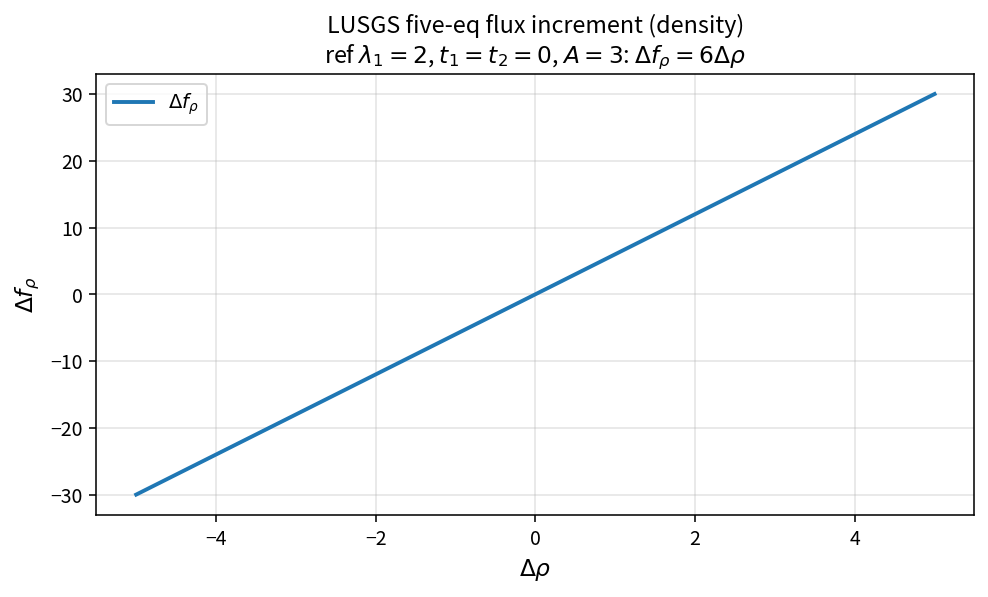

LUSGS five-equation flux increment
==================================

Purpose
-------

Approximate the inviscid flux Jacobian contribution for one LUSGS sweep
face, scaled by face area:

.. math::

   \Delta\mathbf{f} \approx (A_{\mathrm{split}}\,\Delta\mathbf{q})\,A

Density component (simplified sample with \(t_1=t_2=0\)):

.. math::

   \Delta f_\rho = \lambda_1\,\Delta\rho\,A

Source map
----------

* ``LusgsFluxIncrementFiveEq`` in ``NsLusgsPolicy``
* Upstream: ``LusgsSplitFaceEigenvalues``, ``LusgsLinearizationWeights``
* Tests: ``tests/solver/lusgs_policy_test.cpp``
* Theory table: ``tools/verification/data/ns_lusgs_flux_increment_theory.csv``
* Contract Workbench id: ``ns_lusgs_flux_increment``

What this proves / does not prove
---------------------------------

**Proves:** density-increment algebra and normal term2 sample match the pure API.

**Does not prove:** full LUSGS convergence or residual equivalence on a case.

References
----------

* Yoon–Jameson LUSGS; Blazek implicit methods chapters.
* OneFLOW ``NsLusgsPolicy`` pure API family.
