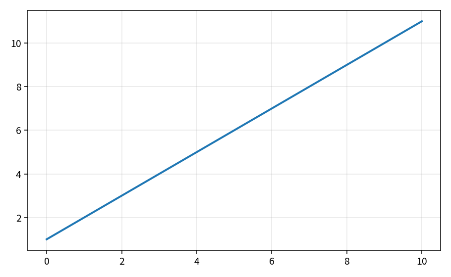

Mean-flow spectral radius and local time step
=============================================

Inviscid face spectral radius
-----------------------------

.. math::

   \lambda_{\mathrm{inv}} = \frac{A}{2}\big(|v_n|+c\big)

Pure API: ``InviscidFaceSpectralRadius``. Theory curve (reference
:math:`A=2`, :math:`c=1`):

``tools/verification/data/ns_inviscid_spectrum_theory.csv``

Cell time step
--------------

.. math::

   \Delta t = \mathrm{CFL}\,\frac{V}{\lambda},\qquad
   \Delta t \leftarrow \frac{\Delta t_{\mathrm{inv}}\Delta t_{\mathrm{vis}}}
   {\Delta t_{\mathrm{inv}}+\Delta t_{\mathrm{vis}}}

Locks: ``timestep_policy_test``. Contract Workbench entry
``ns_inviscid_spectrum``.

**Proves:** pure spectrum and dt algebra. **Does not prove:** case CFL limits.
