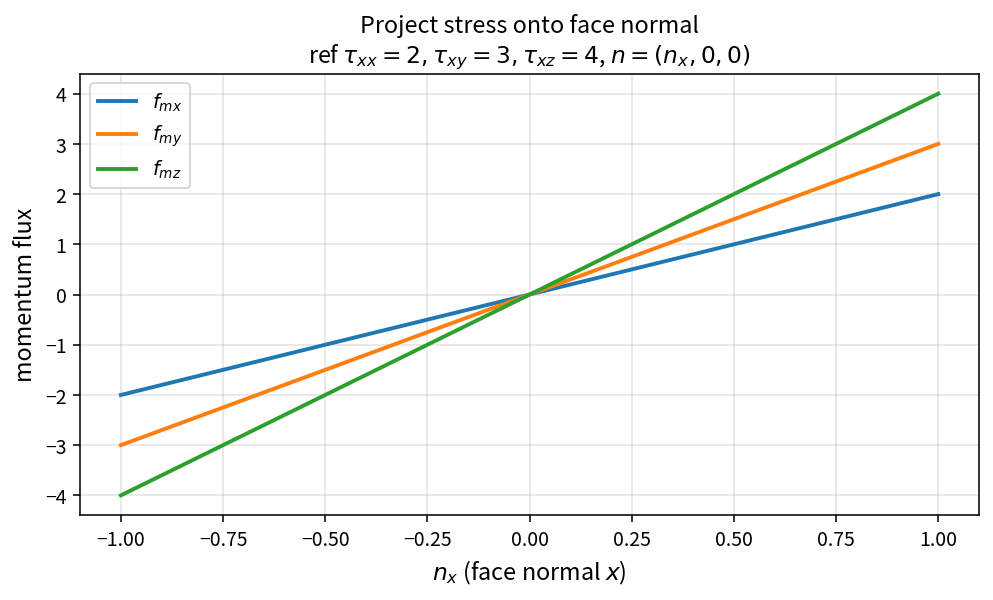

Project stress momentum flux
============================

Purpose
-------

After the Stokes stress is formed, the viscous **momentum** face flux is the
contraction of the stress tensor with the face normal.

Formula
-------

.. math::

   \mathbf{f}_m = \boldsymbol{\tau}\cdot\mathbf{n}

Component-wise:

.. math::

   f_{mx}=n_x\tau_{xx}+n_y\tau_{xy}+n_z\tau_{xz}

   f_{my}=n_x\tau_{xy}+n_y\tau_{yy}+n_z\tau_{yz}

   f_{mz}=n_x\tau_{xz}+n_y\tau_{yz}+n_z\tau_{zz}

Source map
----------

* ``ProjectStressMomentumFlux`` in ``NsVisFluxPolicy``
* Upstream: ``StokesStressTensor``
* Downstream: ``ViscousEnergyFlux``
* Tests: ``tests/solver/vis_flux_policy_test.cpp``
* Theory table: ``tools/verification/data/project_stress_momentum_flux_theory.csv``
* Contract Workbench id: ``project_stress_momentum_flux``

What this proves / does not prove
---------------------------------

**Proves:** \(\boldsymbol{\tau}\cdot\mathbf{n}\) algebra matches the pure API.

**Does not prove:** full viscous residual or Reynolds-number scaling on a case.

References
----------

* Standard finite-volume viscous flux assembly.
* Related: :doc:`stokes_stress_pure_shear`.
