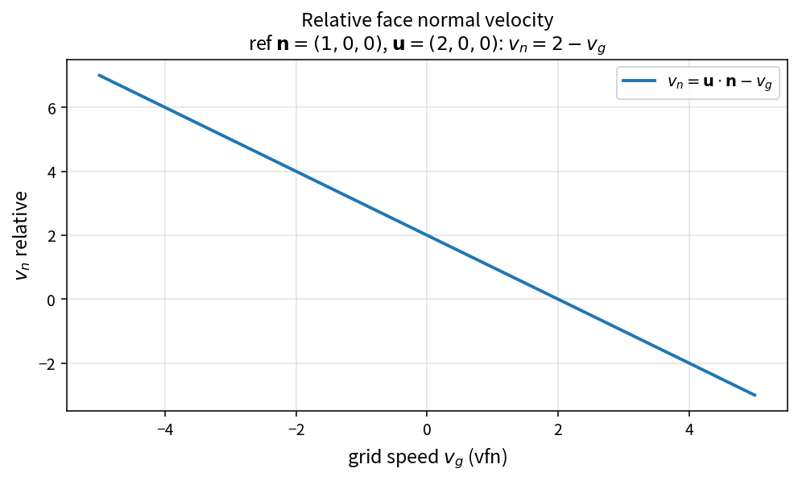

Relative face normal velocity
=============================

Purpose
-------

Face fluxes use the **relative** normal velocity so that grid motion
(or a stationary mesh with \(v_g=0\)) is handled uniformly.

Formula
-------

.. math::

   v_n = \mathbf{u}\cdot\mathbf{n} - v_g

Source map
----------

* ``RelativeFaceNormalVelocity`` in ``NsInvFluxPolicy``
* Downstream: ``FaceMachNumber``, Euler/Roe/AUSM face flux assembly
* Tests: ``tests/solver/inv_flux_policy_test.cpp``
* Theory table: ``tools/verification/data/relative_face_normal_velocity_theory.csv``
* Contract Workbench id: ``relative_face_normal_velocity``

What this proves / does not prove
---------------------------------

**Proves:** \(v_n=\mathbf{u}\cdot\mathbf{n}-v_g\) matches the pure API.

**Does not prove:** full ALE residual or mesh-motion time accuracy.

References
----------

* Arbitrary Lagrangian–Eulerian finite-volume formulations.
* Related: :doc:`face_mach_number`.
