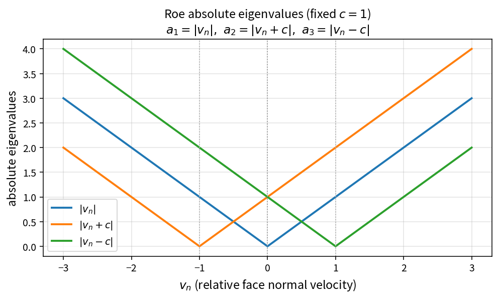

Roe absolute eigenvalues
========================

Purpose
-------

The Roe approximate Riemann solver dissipates using absolute characteristic
speeds. OneFLOW isolates that step as the pure policy
``RoeAbsoluteEigenvalues``.

Formula
-------

With relative face-normal velocity :math:`v_n` and sound speed :math:`c`:

.. math::

   a_1 = |v_n|,\qquad
   a_2 = |v_n + c|,\qquad
   a_3 = |v_n - c|

Source map
----------

* ``RoeAbsoluteEigenvalues`` in ``NsInvFluxPolicy``
* Downstream: ``ApplyHartenEntropyFix``, ``RoeDissipationWaveCoefficients``
* Tests: ``tests/solver/inv_flux_policy_test.cpp``
* Theory table: ``tools/verification/data/roe_absolute_eigenvalues_theory.csv``
* Contract Workbench id: ``roe_absolute_eigenvalues``

What this proves / does not prove
---------------------------------

**Proves:** absolute-value branches match the pure API on a :math:`v_n` grid.

**Does not prove:** assembled Roe flux, entropy-fix interaction, or case residuals.
