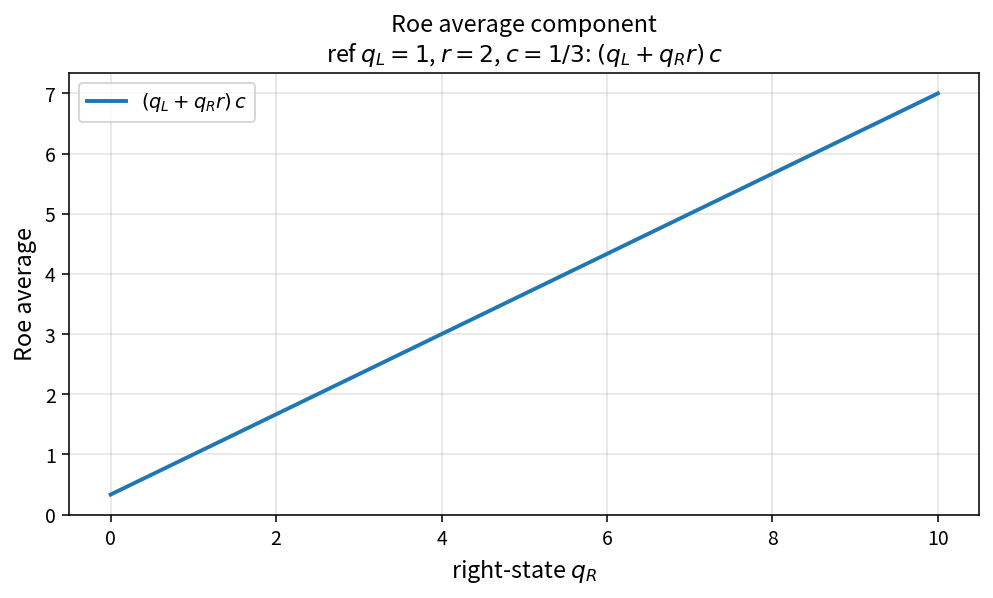

Roe average component
=====================

Purpose
-------

Blend a left/right scalar with Roe density weights to form one component of
the Roe-averaged face state.

Formula
-------

.. math::

   r=\sqrt{\frac{\rho_R}{\rho_L}},\qquad
   c=\frac{1}{1+r},\qquad
   \tilde{q}=(q_L + q_R\,r)\,c

Source map
----------

* ``RoeAverageComponent``, ``RoeAverageWeights`` in ``NsInvFluxPolicy``
* Assembled by ``RoeAverageState``
* Tests: ``tests/solver/inv_flux_policy_test.cpp``
* Theory table: ``tools/verification/data/roe_average_component_theory.csv``
* Contract Workbench id: ``roe_average_component``

What this proves / does not prove
---------------------------------

**Proves:** weighted-mean algebra and consistency with ``RoeAverageWeights``.

**Does not prove:** full Roe numerical flux or shock-capturing quality.

References
----------

* P. L. Roe, approximate Riemann solvers; Toro, Riemann solvers.
* Related: :doc:`roe_average_weights`, Roe dissipation intermediates.
