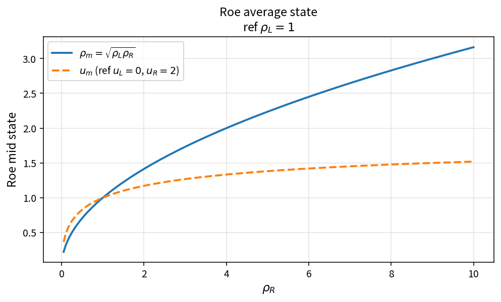

Roe average state
=================

Purpose
-------

Assemble the Roe mid-face average state from left and right primitives.

Formula
-------

.. math::

   \rho_m = \sqrt{\rho_L\rho_R}

.. math::

   r=\sqrt{\frac{\rho_R}{\rho_L}},\qquad
   \phi_m = \frac{\phi_L + \phi_R r}{1+r}

for velocity components, pressure, total enthalpy and \(\gamma\).

Source map
----------

* ``RoeAverageState`` in ``NsInvFluxPolicy``
* Building blocks: ``RoeAverageWeights``, ``RoeAverageComponent``
* Tests: ``tests/solver/inv_flux_policy_test.cpp``
* Theory table: ``tools/verification/data/roe_average_state_theory.csv``
* Contract Workbench id: ``roe_average_state``

What this proves / does not prove
---------------------------------

**Proves:** Roe mid-state algebra matches the pure API on a density-ratio grid.

**Does not prove:** full Roe flux residual or entropy-fix interaction.

References
----------

* Roe, Approximate Riemann solvers (1981).
* Related catalog: ``roe_average_weights``, ``roe_average_component``.
