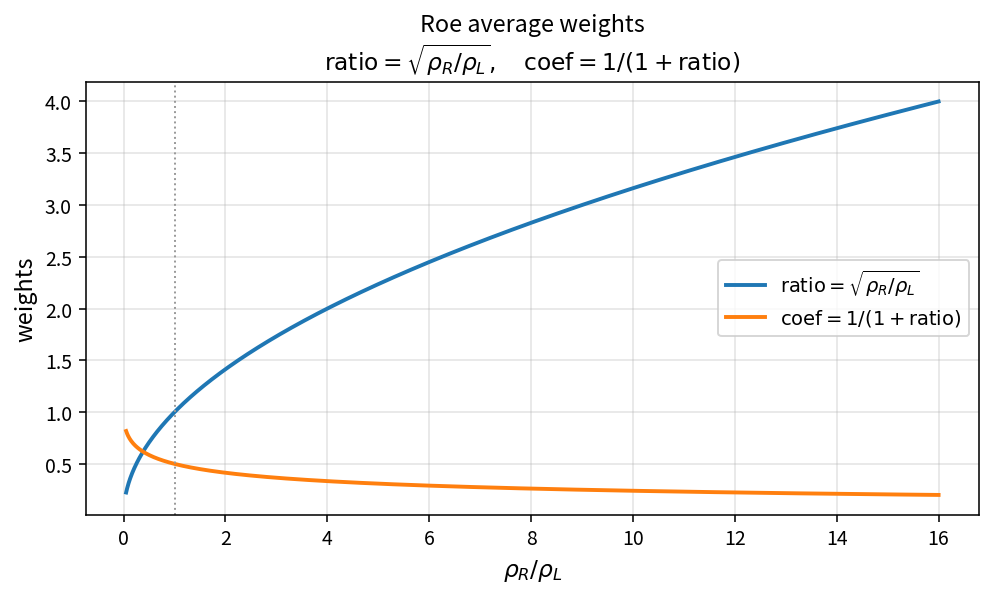

Roe average weights
===================

Purpose
-------

The Roe interface state is a density-weighted blend of the left and right
primitives. OneFLOW isolates the weights as the pure policy
``RoeAverageWeights``.

Formula
-------

.. math::

   \mathrm{ratio} = \sqrt{\frac{\rho_R}{\rho_L}},\qquad
   \mathrm{coef}  = \frac{1}{1+\mathrm{ratio}}

A generic component then averages as
:math:`(q_L + q_R\cdot\mathrm{ratio})\cdot\mathrm{coef}`.

Source map
----------

* ``RoeAverageWeights``, ``RoeAverageComponent``, ``RoeAverageState``
* Tests: ``tests/solver/inv_flux_policy_test.cpp``
* Theory table: ``tools/verification/data/roe_average_weights_theory.csv``
* Contract Workbench id: ``roe_average_weights``

What this proves / does not prove
---------------------------------

**Proves:** weight algebra matches the pure API on a density-ratio grid.

**Does not prove:** full Roe-averaged pressure/enthalpy consistency or flux residual.
