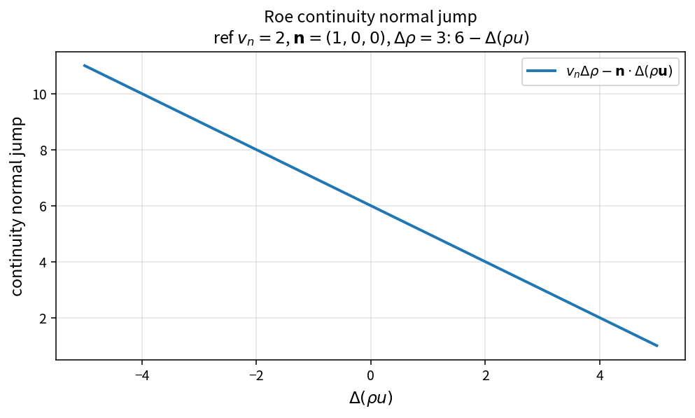

Roe continuity normal jump
==========================

Purpose
-------

Evaluate the continuity-related jump that enters Roe dissipation wave
strengths.

Formula
-------

.. math::

   J_{\rho}
   = v_n\Delta\rho - \mathbf{n}\cdot\Delta(\rho\mathbf{u})

Source map
----------

* ``RoeContinuityNormalJump`` in ``NsInvFluxPolicy``
* Tests: ``tests/solver/inv_flux_policy_test.cpp``
* Theory table: ``tools/verification/data/roe_continuity_normal_jump_theory.csv``
* Contract Workbench id: ``roe_continuity_normal_jump``

What this proves / does not prove
---------------------------------

**Proves:** jump algebra matches the pure API.

**Does not prove:** full Roe numerical flux quality.

References
----------

* Roe approximate Riemann solver; Toro, Riemann solvers.
* Related Roe intermediates in the Contract Workbench catalog.
