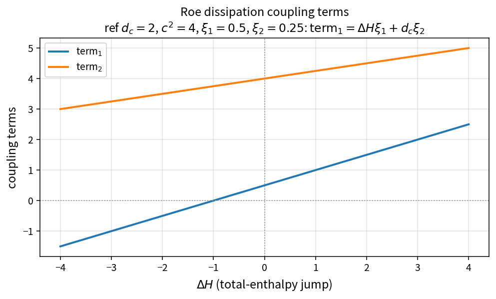

Roe dissipation coupling terms
==============================

Purpose
-------

After wave coefficients :math:`\xi_1,\xi_2` are formed, Roe dissipation still
needs two scalars that couple the density and total-enthalpy jumps into the
five conserved-flux equations.

Formula
-------

.. math::

   \mathrm{term}_1 = \Delta H\,\xi_1 + d_c\,\xi_2

   \mathrm{term}_2 = c^{2}\,d_c\,\xi_1 + \Delta H\,\xi_2

Source map
----------

* ``RoeDissipationCouplingTerms`` in ``NsInvFluxPolicy``
* Upstream: ``RoeDissipationWaveCoefficients``
* Downstream: ``ApplyRoeDissipationFiveEq``
* Tests: ``tests/solver/inv_flux_policy_test.cpp``
* Theory table: ``tools/verification/data/roe_dissipation_coupling_theory.csv``
* Contract Workbench id: ``roe_dissipation_coupling``

What this proves / does not prove
---------------------------------

**Proves:** bilinear coupling algebra matches the pure API on a sample grid.

**Does not prove:** assembled Roe face residual or shock-capturing quality.
