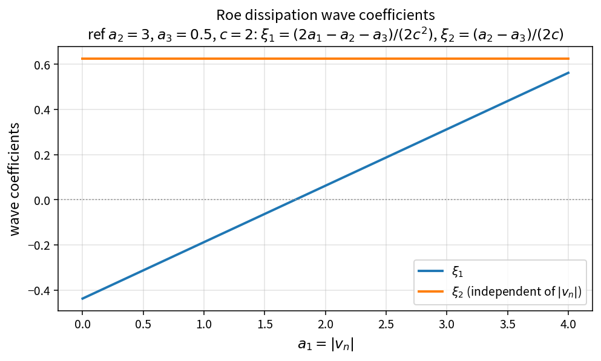

Roe dissipation wave coefficients
=================================

Purpose
-------

After absolute eigenvalues (and optional Harten floors) are formed, Roe
dissipation needs two scalar coefficients that weight the continuity and
total-enthalpy jumps.

Formula
-------

With :math:`a_1=|v_n|`, :math:`a_2=|v_n+c|`, :math:`a_3=|v_n-c|`:

.. math::

   \xi_1=\frac{2a_1-a_2-a_3}{2c^{2}},\qquad
   \xi_2=\frac{a_2-a_3}{2c}

Note that :math:`\xi_2` does not depend on :math:`a_1`.

Source map
----------

* ``RoeDissipationWaveCoefficients`` in ``NsInvFluxPolicy``
* Upstream: ``RoeAbsoluteEigenvalues``, ``ApplyHartenEntropyFix``
* Downstream: ``RoeDissipationCouplingTerms``, ``ApplyRoeDissipationFiveEq``
* Tests: ``tests/solver/inv_flux_policy_test.cpp``
* Theory table: ``tools/verification/data/roe_dissipation_wave_coeff_theory.csv``
* Contract Workbench id: ``roe_dissipation_wave_coeff``

What this proves / does not prove
---------------------------------

**Proves:** coefficient algebra matches the pure API on a sample grid.

**Does not prove:** assembled Roe face flux or case-level dissipation strength.
