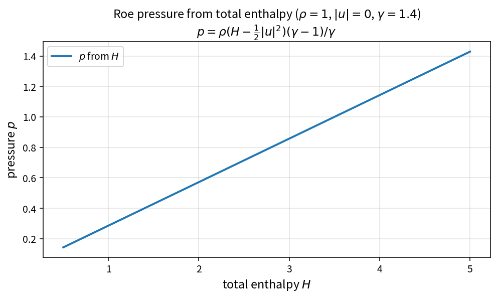

Roe pressure from total enthalpy
================================

Purpose
-------

Compressible LUSGS can recover face pressure from the Roe-averaged total
enthalpy (mode 0). The pure policy is ``RoePressureFromTotalEnthalpy``.

Formula
-------

.. math::

   p = \rho\left(H-\frac{1}{2}|u|^{2}\right)\frac{\gamma-1}{\gamma}

Source map
----------

* ``RoePressureFromTotalEnthalpy``
* ``LusgsFacePressureFromMode`` (mode 0 selects this closure)
* Tests: ``tests/solver/inv_flux_policy_test.cpp``
* Theory table: ``tools/verification/data/roe_pressure_from_enthalpy_theory.csv``
* Contract Workbench id: ``roe_pressure_from_enthalpy``

What this proves / does not prove
---------------------------------

**Proves:** pressure-from-enthalpy algebra matches the pure API on sample states.

**Does not prove:** mode-1 Roe-weighted pressure path or full LUSGS residuals.
