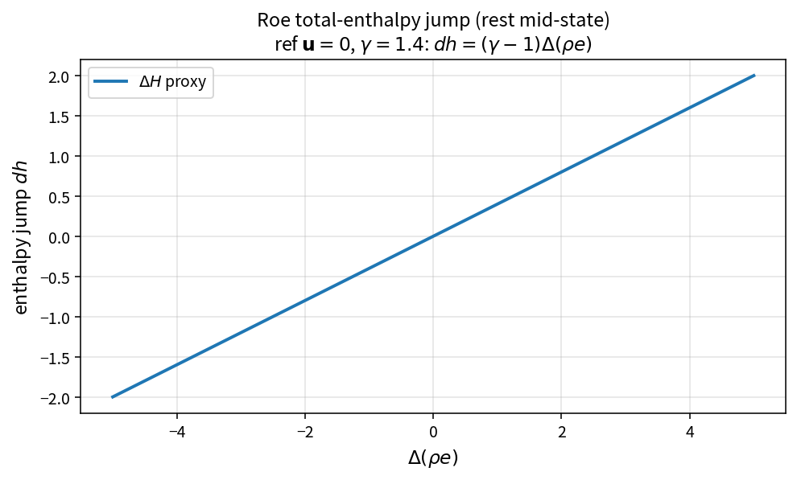

Roe total-enthalpy jump
=======================

Purpose
-------

Evaluate the enthalpy-related jump that couples into Roe dissipation terms.

Formula
-------

.. math::

   dh
   =
   -(\gamma-1)\bigl(\mathbf{u}\cdot\Delta(\rho\mathbf{u})-\Delta(\rho e)\bigr)
   +
   \tfrac12(\gamma-1)|u|^{2}\,\Delta\rho

At rest mid-state (\(\mathbf{u}=0\)):

.. math::

   dh=(\gamma-1)\,\Delta(\rho e)

Source map
----------

* ``RoeTotalEnthalpyJump`` in ``NsInvFluxPolicy``
* Downstream: ``RoeDissipationCouplingTerms``
* Tests: ``tests/solver/inv_flux_policy_test.cpp``
* Theory table: ``tools/verification/data/roe_total_enthalpy_jump_theory.csv``
* Contract Workbench id: ``roe_total_enthalpy_jump``

What this proves / does not prove
---------------------------------

**Proves:** jump algebra matches the pure API on energy and kinetic samples.

**Does not prove:** full Roe flux residual quality.

References
----------

* Roe approximate Riemann solver; Toro, Riemann solvers.
* Related: :doc:`roe_continuity_normal_jump`.
