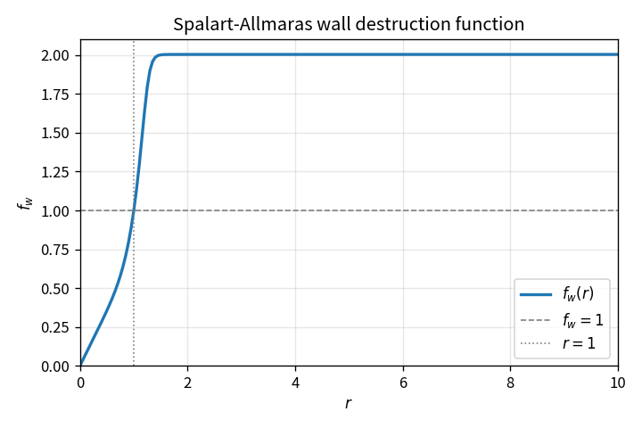

Spalart-Allmaras closure functions
==================================

The SA one-equation model evaluates a chain of nondimensional closure
functions from the working variable :math:`\tilde\nu` and the local
strain/vorticity magnitude.

Core definitions
----------------

.. math::

   \chi = \frac{\tilde\nu}{\nu},
   \qquad
   f_{v1} = \frac{\chi^3}{\chi^3+c_{v1}^3},
   \qquad
   f_{v2} = 1 - \frac{\chi}{1+\chi f_{v1}}

Modified strain
---------------

With :math:`r_s = \tilde\nu/(\kappa^2 d^2)` (including Reynolds scaling
in the solver) and :math:`\bar S = r_s f_{v2}`:

.. math::

   \tilde S =
   \begin{cases}
   \Omega + \bar S & \bar S \ge -c_2\Omega \\
   \Omega\big(1 + \frac{c_2^2\Omega + c_3\bar S}
   {(c_3-2c_2)\Omega - \bar S}\big) & \text{otherwise}
   \end{cases}

Wall destruction function
-------------------------

.. math::

   r = \min(r_s/\tilde S,\,10),
   \quad
   g = r + c_{w2}(r^6-r),
   \quad
   f_w = g\Big(\frac{1+c_{w3}^6}{g^6+c_{w3}^6}\Big)^{1/6}

Optional trip function :math:`f_{t2}=c_{t3}\exp(-c_{t4}\chi^2)`.

Role of the wall destruction function
-------------------------------------

The Spalart–Allmaras working-variable equation balances **production**
of :math:`\tilde\nu` against **destruction** near walls. The destruction
term has the structure

.. math::

   D \sim c_{w1} f_w \left(\frac{\tilde\nu}{d}\right)^2

where :math:`d` is wall distance. Without a carefully shaped
:math:`f_w`, a pure :math:`(\tilde\nu/d)^2` sink either under-damps in the
outer layer or mis-calibrates the log layer.

Definition of the intermediate ratio
~~~~~~~~~~~~~~~~~~~~~~~~~~~~~~~~~~~~

.. math::

   r = \min\left(
   \frac{\tilde\nu}{\tilde S\,\kappa^2 d^2},\, 10
   \right)

Qualitatively:

* **Near a solid wall** (:math:`\tilde\nu\to 0` or large :math:`\tilde S d^2`):
  :math:`r\to 0`, hence :math:`f_w\to 0`. Destruction vanishes together with
  :math:`\tilde\nu`, which is consistent with a laminar sublayer.
* **Log layer calibration point**: :math:`r=1` yields :math:`f_w=1`.
  The constants are chosen so that the model recovers the standard
  logarithmic law with :math:`\kappa\approx 0.41`.
* **Outer / wake region** (:math:`r>1`): :math:`f_w>1`, so destruction is
  **stronger** than the bare :math:`(\tilde\nu/d)^2` term. That extra sink
  prevents an unrealistically thick turbulent viscosity away from the wall
  and is part of the original SA outer-layer calibration.

The auxiliary map :math:`g(r)=r+c_{w2}(r^6-r)` is a monotone nonlinear
stretch of :math:`r` (with :math:`c_{w2}=0.3`) before the smooth
:math:`f_w(g)` factor (with :math:`c_{w3}=2`). The composition is smooth,
:math:`C^1`-friendly for Newton/LUSGS linearizations, and bounded for
:math:`r\in[0,10]`.

Shape of :math:`f_w(r)`
~~~~~~~~~~~~~~~~~~~~~~

The theory curve (standard constants) starts at the origin, passes through
:math:`(1,1)`, then rises gradually toward an outer plateau as
:math:`r\to 10`. Regeneratable data and figure:

* CSV: ``tools/verification/data/sa_fw_r_theory.csv``
* Plot script: ``tools/verification/plot_sa_fw.py``

.. code-block:: bash

   python tools/verification/plot_sa_fw.py

**Proves (with pure API tests):** algebra of ``SaG`` / ``SaFw`` matches the
published formula at sample points.

**Does not prove:** wall-distance field quality, full ``CalcSrcSa`` residual,
skin friction, or experimental agreement.

References
----------

* Spalart, P. R. and Allmaras, S. R. (1992/1994). A one-equation
  turbulence model for aerodynamic flows.
* Allmaras, S. R., Johnson, F. T., Spalart, P. R. Modifications and
  clarifications for the implementation of the Spalart-Allmaras model.
* NASA Turbulence Modeling Resource (SA equations and constants).
* See ``references.rst`` for the citation policy and self-evolution loop.

Pure APIs: ``TurbSaPolicy.h``. Tests: ``turb_sa_policy_test``.
Wiring: ``TurbCom::CalcSrcSa``.
