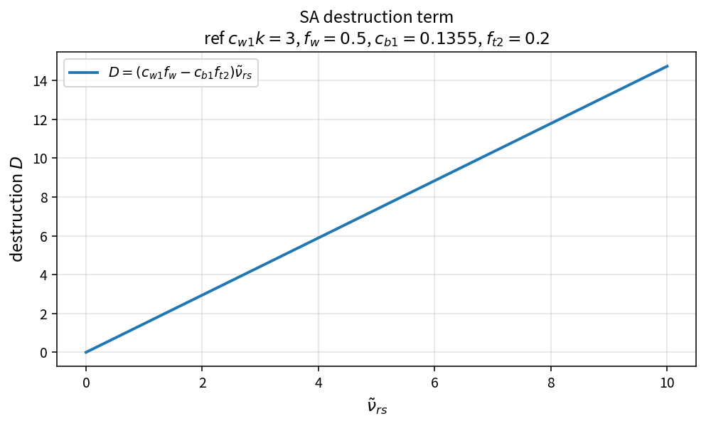

SA destruction term
===================

Purpose
-------

Evaluate the Spalart–Allmaras destruction contribution to the working-variable
source residual.

Formula
-------

.. math::

   D = \bigl(c_{w1}f_w - c_{b1}f_{t2}\bigr)\,\tilde{\nu}_{rs}

where \(\tilde{\nu}_{rs}\) is the wall-scaled working-variable measure used by
OneFLOW (typically \(\tilde{\nu}/d^{2}\) class).

Source map
----------

* ``SaDestruction`` in ``TurbSaPolicy``
* Upstream: ``SaFw`` (and related closures)
* Downstream: ``SaSourceResidual``
* Tests: ``tests/solver/turb_sa_policy_test.cpp``
* Theory table: ``tools/verification/data/sa_destruction_theory.csv``
* Contract Workbench id: ``sa_destruction``

What this proves / does not prove
---------------------------------

**Proves:** destruction algebra matches the pure API on a \(\tilde{\nu}_{rs}\) grid.

**Does not prove:** full SA residual or wall-distance accuracy.

References
----------

* Spalart–Allmaras model; NASA Turbulence Modeling Resource (SA).
* Related: :doc:`sa_production`, ``sa_fw`` catalog entries.
