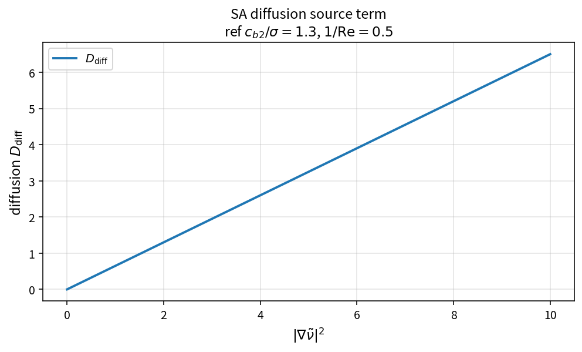

SA diffusion source term
========================

Purpose
-------

Evaluate the Spalart–Allmaras non-conservative diffusion contribution to the
working-variable source residual.

Formula
-------

.. math::

   D_{\mathrm{diff}}
   =
   \frac{c_{b2}}{\sigma}\,|\nabla\tilde{\nu}|^{2}/\mathrm{Re}

Source map
----------

* ``SaDiffusion`` in ``TurbSaPolicy``
* Downstream: ``SaLimitedDiffusion``, ``SaSourceResidual``
* Tests: ``tests/solver/turb_sa_policy_test.cpp``
* Theory table: ``tools/verification/data/sa_diffusion_theory.csv``
* Contract Workbench id: ``sa_diffusion``

What this proves / does not prove
---------------------------------

**Proves:** diffusion algebra matches the pure API on a \(|\nabla\tilde{\nu}|^{2}\) grid.

**Does not prove:** full SA residual or production-limited diffusion interaction.

References
----------

* Spalart–Allmaras model; NASA TMR SA.
* Related: :doc:`sa_production`, :doc:`sa_destruction`, :doc:`sa_source_residual`.
