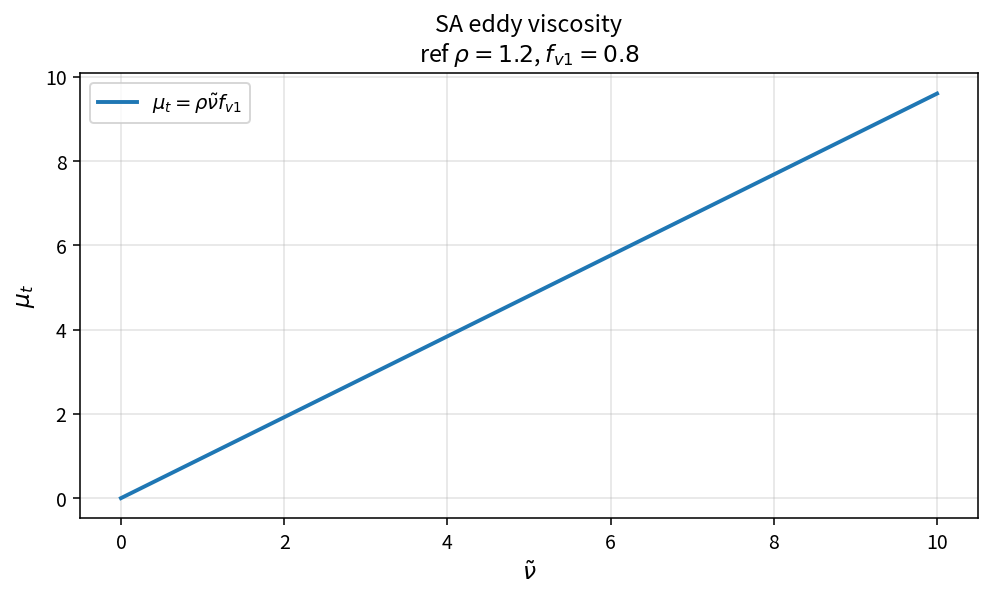

SA eddy viscosity
=================

Purpose
-------

Evaluate the Spalart–Allmaras turbulent eddy viscosity from density, working
variable and \(f_{v1}\).

Formula
-------

.. math::

   \mu_t = \rho\,\tilde{\nu}\,f_{v1}

Source map
----------

* ``SaEddyViscosity`` in ``TurbSaPolicy``
* Upstream: ``SaChi``, ``SaFv1``
* Full pipeline: ``SaComputeEddyViscosity``
* Tests: ``tests/solver/turb_sa_policy_test.cpp``
* Theory table: ``tools/verification/data/sa_eddy_viscosity_theory.csv``
* Contract Workbench id: ``sa_eddy_viscosity``

What this proves / does not prove
---------------------------------

**Proves:** \(\mu_t=\rho\tilde{\nu}f_{v1}\) matches the pure API.

**Does not prove:** full capped cell-closure pipeline on a wall-bounded case.

References
----------

* Spalart–Allmaras model; NASA TMR SA.
* Related catalog: ``sa_fv1_chi``.
