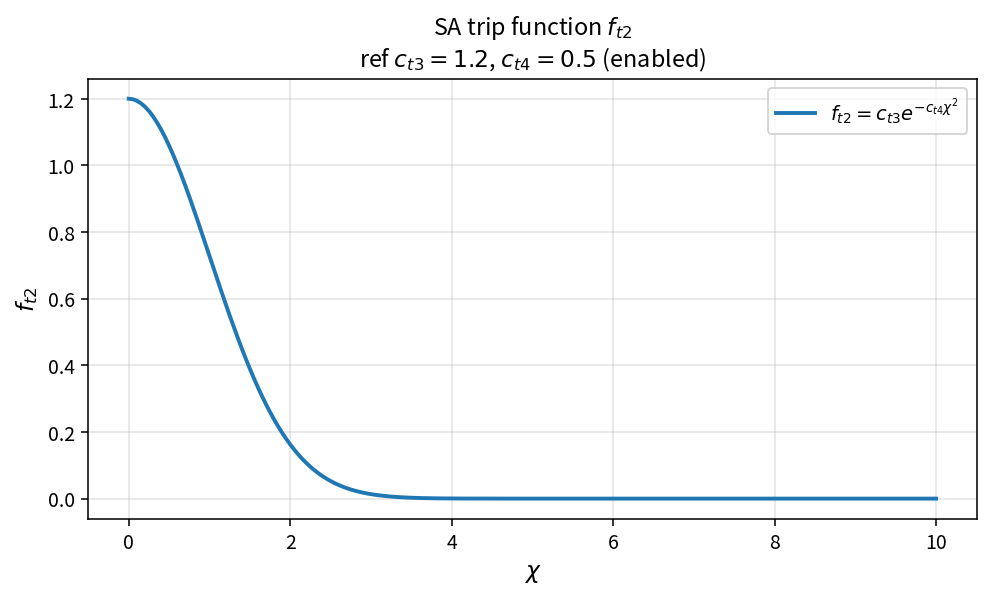

SA trip function ft2
====================

Purpose
-------

Evaluate the optional Spalart–Allmaras trip / laminar-suppression function
\(f_{t2}\).

Formula
-------

When enabled:

.. math::

   f_{t2} = c_{t3}\,e^{-c_{t4}\chi^{2}}

When disabled, \(f_{t2}=0\).

Source map
----------

* ``SaFt2`` in ``TurbSaPolicy``
* Downstream: ``SaProduction``, ``SaDestruction``
* Tests: ``tests/solver/turb_sa_policy_test.cpp``
* Theory table: ``tools/verification/data/sa_ft2_theory.csv``
* Contract Workbench id: ``sa_ft2``

What this proves / does not prove
---------------------------------

**Proves:** enabled \(f_{t2}\) algebra and disabled path match the pure API.

**Does not prove:** transition prediction quality on a case mesh.

References
----------

* Spalart–Allmaras model; NASA TMR SA.
* Related: :doc:`sa_production`, :doc:`sa_destruction`.
