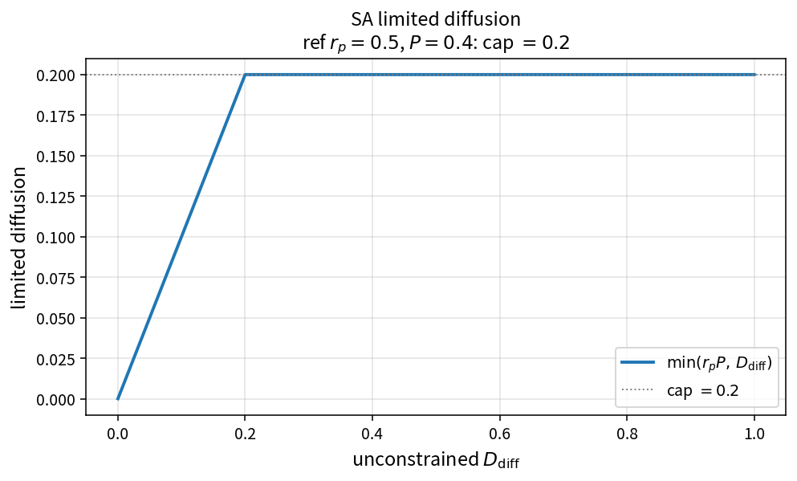

SA limited diffusion
====================

Purpose
-------

Cap the SA non-conservative diffusion contribution relative to production.

Formula
-------

.. math::

   D_{\mathrm{lim}} = \min(r_p P,\,D_{\mathrm{diff}})

Source map
----------

* ``SaLimitedDiffusion`` in ``TurbSaPolicy``
* Upstream: ``SaDiffusion``, ``SaProduction``
* Downstream: ``SaSourceResidual``
* Tests: ``tests/solver/turb_sa_policy_test.cpp``
* Theory table: ``tools/verification/data/sa_limited_diffusion_theory.csv``
* Contract Workbench id: ``sa_limited_diffusion``

What this proves / does not prove
---------------------------------

**Proves:** \(\min(r_p P, D_{\mathrm{diff}})\) matches the pure API.

**Does not prove:** full SA residual field on a wall-bounded case.

References
----------

* Spalart–Allmaras implementation practice; NASA TMR SA.
* Related: :doc:`sa_diffusion`, :doc:`sa_source_residual`.
