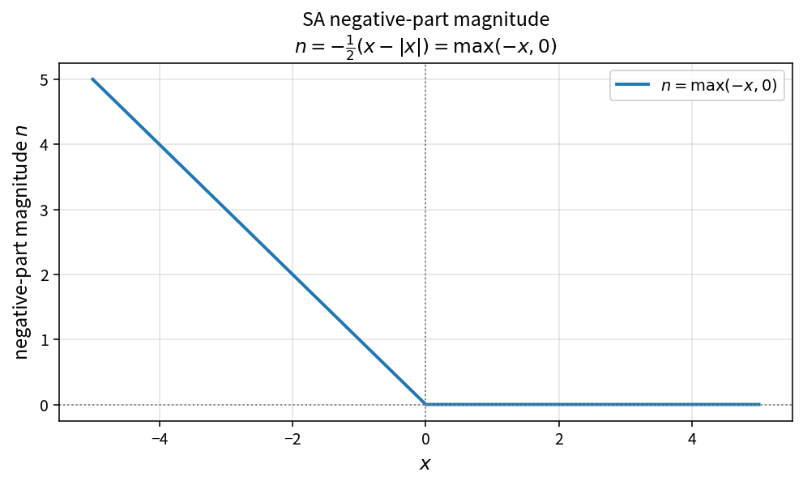

SA negative-part magnitude
==========================

Purpose
-------

Extract the magnitude of the negative part of a residual contribution.

Formula
-------

.. math::

   n = \max(-x,0)

Implementation form:

.. math::

   n = -\tfrac12(x-|x|)

Note the contrast with ``SstNegativeSourcePart``, which returns the signed
value \(\min(S,0)\).

Source map
----------

* ``SaNegativePart`` in ``TurbSaPolicy``
* Tests: ``tests/solver/turb_sa_policy_test.cpp``
* Theory table: ``tools/verification/data/sa_negative_part_theory.csv``
* Contract Workbench id: ``sa_negative_part``

What this proves / does not prove
---------------------------------

**Proves:** negative-part magnitude algebra matches the pure API.

**Does not prove:** full residual Jacobian on a case mesh.

References
----------

* SA residual linearization practice.
* Related: SST ``sst_negative_source_part`` (signed form).
