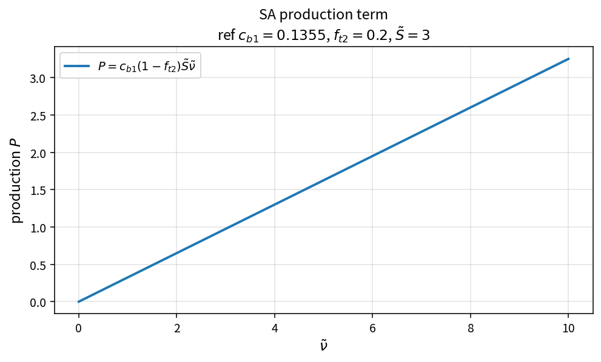

SA production term
==================

Purpose
-------

Evaluate the Spalart–Allmaras production contribution to the working-variable
source residual.

Formula
-------

.. math::

   P = c_{b1}(1-f_{t2})\,\tilde{S}\,\tilde{\nu}

Source map
----------

* ``SaProduction`` in ``TurbSaPolicy``
* Downstream: ``SaSourceResidual`` (with destruction and limited diffusion)
* Tests: ``tests/solver/turb_sa_policy_test.cpp``
* Theory table: ``tools/verification/data/sa_production_theory.csv``
* Contract Workbench id: ``sa_production``

What this proves / does not prove
---------------------------------

**Proves:** production algebra matches the pure API on a \(\tilde{\nu}\) grid.

**Does not prove:** full SA residual or wall-bounded case accuracy.

References
----------

* Spalart–Allmaras model; NASA Turbulence Modeling Resource (SA).
* Related closures: :doc:`sa_fw`, fv1/fv2 intermediates in the catalog.
