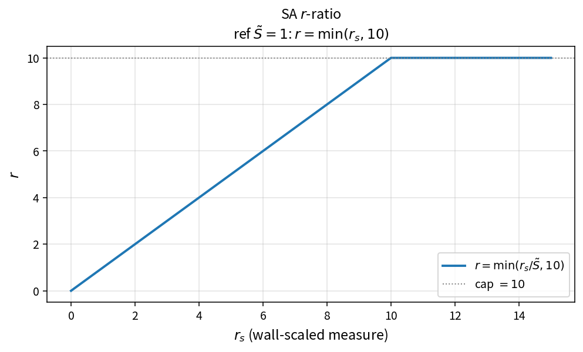

SA r-ratio
==========

Purpose
-------

Evaluate the Spalart–Allmaras ratio \(r\) that feeds the wall-destruction
function \(f_w\).

Formula
-------

.. math::

   r = \min\!\left(\frac{r_s}{\tilde{S}},\,10\right)

Source map
----------

* ``SaRRatio`` in ``TurbSaPolicy``
* Downstream: ``SaG``, ``SaFw``
* Tests: ``tests/solver/turb_sa_policy_test.cpp``
* Theory table: ``tools/verification/data/sa_r_ratio_theory.csv``
* Contract Workbench id: ``sa_r_ratio``

What this proves / does not prove
---------------------------------

**Proves:** \(r\) algebra and the hard clamp at 10 match the pure API.

**Does not prove:** full \(f_w\) destruction field on a wall-bounded case.

References
----------

* Spalart–Allmaras model; NASA TMR SA.
* Related catalog: ``sa_fw_r``.
