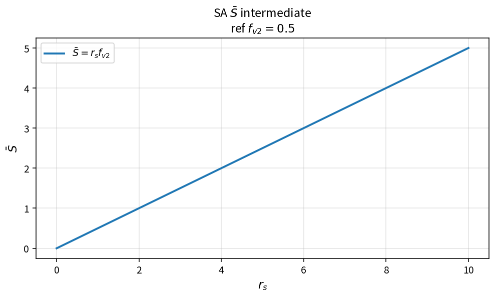

SA S-bar intermediate
=====================

Purpose
-------

Evaluate the Spalart–Allmaras intermediate \(\bar{S}=r_s f_{v2}\) used when
building the modified strain rate for production.

Formula
-------

.. math::

   \bar{S} = r_s f_{v2}

Source map
----------

* ``SaSBar`` in ``TurbSaPolicy``
* Upstream: ``SaFv2``
* Downstream: ``SaModifiedStrainRate``
* Tests: ``tests/solver/turb_sa_policy_test.cpp``
* Theory table: ``tools/verification/data/sa_s_bar_theory.csv``
* Contract Workbench id: ``sa_s_bar``

What this proves / does not prove
---------------------------------

**Proves:** \(\bar{S}\) algebra matches the pure API.

**Does not prove:** full modified-strain / production residual on a case mesh.

References
----------

* Spalart–Allmaras model; NASA TMR SA.
* Related catalog: ``sa_fv2_chi``, production path.
