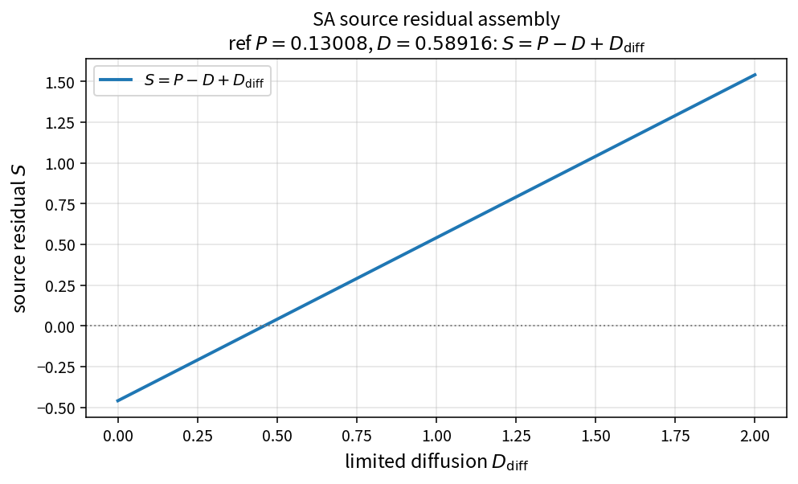

SA source residual assembly
===========================

Purpose
-------

Assemble the SA working-variable source residual from production, destruction
and limited diffusion contributions.

Formula
-------

.. math::

   S = P - D + D_{\mathrm{diff}}

with

.. math::

   P = c_{b1}(1-f_{t2})\tilde{S}\tilde{\nu},\quad
   D = (c_{w1}f_w-c_{b1}f_{t2})\tilde{\nu}_{rs},\quad
   D_{\mathrm{diff}}=\min(r_p P,\,D_{\mathrm{diff}}^{\mathrm{raw}})

Source map
----------

* ``SaSourceResidual`` (and ``SaProduction``, ``SaDestruction``,
  ``SaDiffusion``, ``SaLimitedDiffusion``) in ``TurbSaPolicy``
* Tests: ``tests/solver/turb_sa_policy_test.cpp``
* Theory table: ``tools/verification/data/sa_source_residual_theory.csv``
* Contract Workbench id: ``sa_source_residual``

What this proves / does not prove
---------------------------------

**Proves:** residual assembly algebra and piece composition match pure APIs.

**Does not prove:** full SA residual field on a wall-bounded case mesh.

References
----------

* Spalart–Allmaras model; NASA TMR SA.
* Related: :doc:`sa_production`, :doc:`sa_destruction`.
