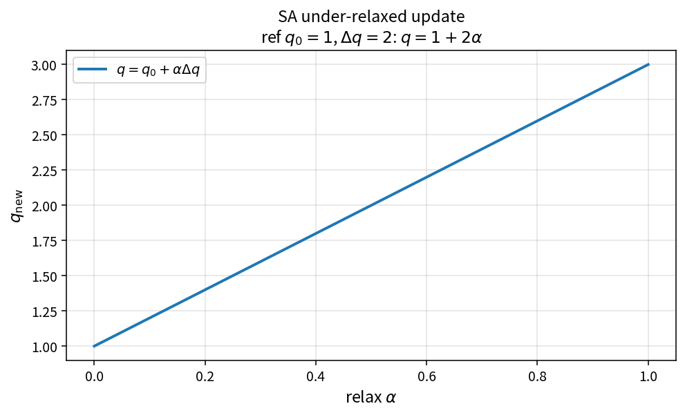

SA under-relaxed update
=======================

Purpose
-------

Apply under-relaxation to an SA working-variable update.

Formula
-------

.. math::

   q = q_0 + \alpha\Delta q

equivalently

.. math::

   q = (1-\alpha)q_0 + \alpha(q_0+\Delta q)

Source map
----------

* ``SaUnderRelaxedUpdate`` in ``TurbSaPolicy``
* Tests: ``tests/solver/turb_sa_under_relax_test.cpp``
* Theory table: ``tools/verification/data/sa_under_relaxed_update_theory.csv``
* Contract Workbench id: ``sa_under_relaxed_update``

What this proves / does not prove
---------------------------------

**Proves:** under-relaxation algebra matches the pure API on an \(\alpha\) grid.

**Does not prove:** optimal \(\alpha\) or case convergence behavior.

References
----------

* Common CFD under-relaxation practice.
* Related SA update bounds: ``SaWorkingVariableUpperBound``,
  ``SaNonNegativeWorkingVariable``.
