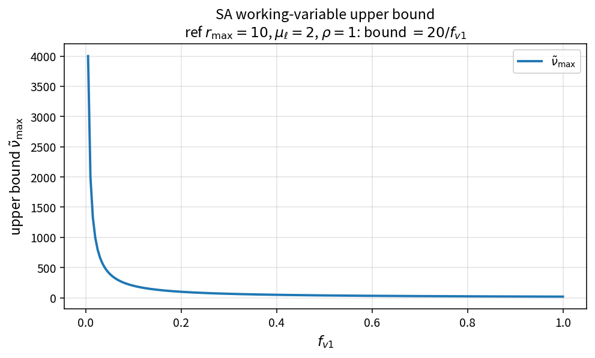

SA working-variable upper bound
===============================

Purpose
-------

Evaluate the upper bound on the SA working variable from a maximum eddy
viscosity ratio.

Formula
-------

.. math::

   \tilde{\nu}_{\max}
   =
   r_{\max}\frac{\mu_\ell}{\rho f_{v1}}

Source map
----------

* ``SaWorkingVariableUpperBound`` in ``TurbSaPolicy``
* Related: ``SaNonNegativeWorkingVariable``, ``SaUnderRelaxedUpdate``
* Tests: ``tests/solver/turb_sa_update_bound_test.cpp``
* Theory table: ``tools/verification/data/sa_working_variable_upper_bound_theory.csv``
* Contract Workbench id: ``sa_working_variable_upper_bound``

What this proves / does not prove
---------------------------------

**Proves:** upper-bound algebra matches the pure API on an \(f_{v1}\) grid.

**Does not prove:** optimal \(r_{\max}\) or full update pipeline on a case.

References
----------

* SA solver robustness practice; NASA TMR SA.
* Related: :doc:`sa_under_relaxed_update`, :doc:`sa_eddy_viscosity`.
