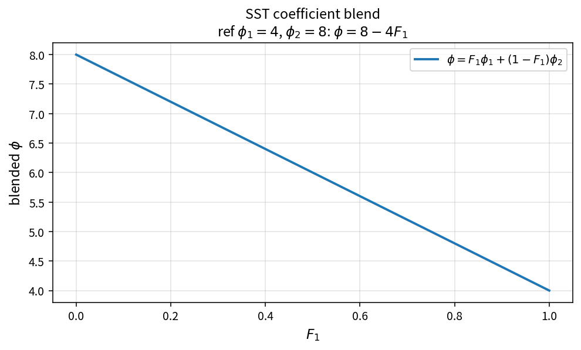

SST coefficient blend
=====================

Purpose
-------

Blend inner and outer SST model coefficients using the \(F_1\) function.

Formula
-------

.. math::

   \phi = F_1\phi_1 + (1-F_1)\phi_2

Source map
----------

* ``SstBlend`` in ``TurbSstPolicy``
* Upstream: ``SstF1FromArg1`` / F1 construction
* Tests: ``tests/solver/turb_sst_policy_test.cpp``
* Theory table: ``tools/verification/data/sst_blend_theory.csv``
* Contract Workbench id: ``sst_blend``

What this proves / does not prove
---------------------------------

**Proves:** convex blend algebra matches the pure API on an \(F_1\) grid.

**Does not prove:** \(F_1\) construction accuracy or full residual field.

References
----------

* Menter, Zonal Two Equation \(k\)-\(\omega\) Turbulence Models (1994).
* NASA Turbulence Modeling Resource (SST).
* Related catalog: ``sst_f1``.
