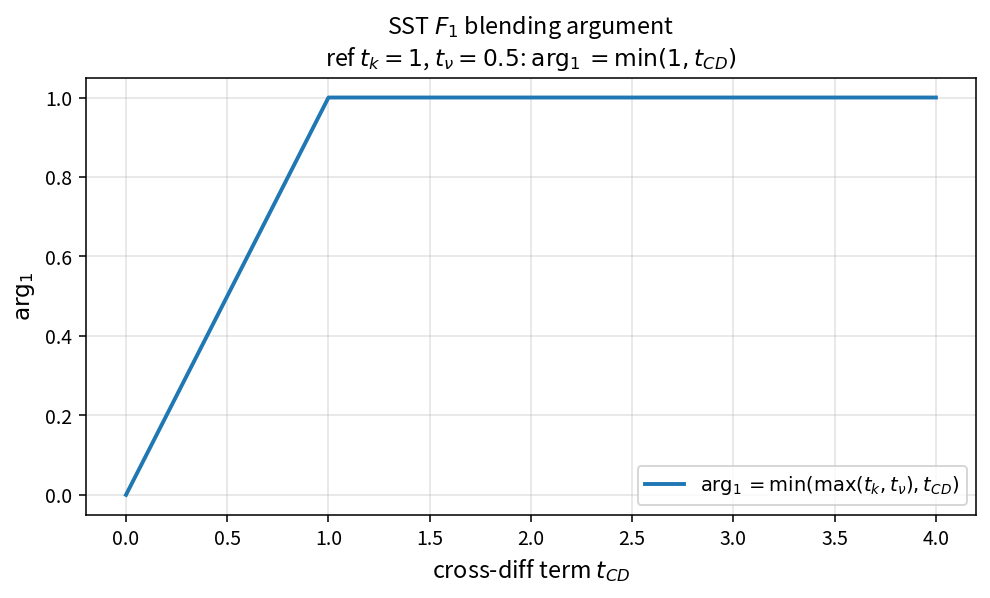

SST F1 blending argument
========================

Purpose
-------

Assemble the argument of the SST \(F_1\) blending function from length-scale,
viscous and cross-diffusion terms.

Formula
-------

.. math::

   \arg_1 = \min(\max(t_k,t_\nu),t_{CD})

Source map
----------

* ``SstBlendingArg1`` in ``TurbSstPolicy``
* Upstream: term construction / ``SstCdkwWithFloor``
* Downstream: ``SstF1FromArg1``
* Tests: ``tests/solver/turb_sst_policy_test.cpp``
* Theory table: ``tools/verification/data/sst_blending_arg1_theory.csv``
* Contract Workbench id: ``sst_blending_arg1``

What this proves / does not prove
---------------------------------

**Proves:** \(\arg_1\) algebra matches the pure API.

**Does not prove:** full \(F_1\) field accuracy on a case mesh.

References
----------

* Menter SST (1994); NASA TMR SST.
* Related: :doc:`sst_cdkw_with_floor`, catalog ``sst_f1``.
