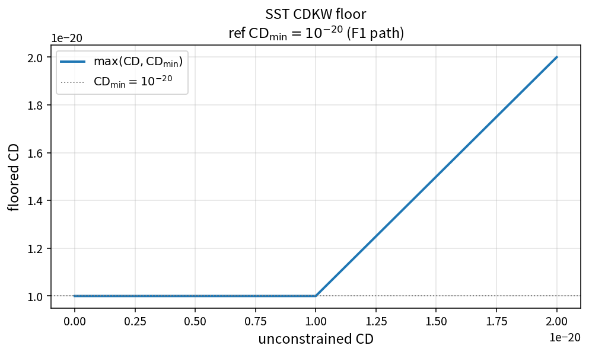

SST CDKW floor
==============

Purpose
-------

Floor the cross-diffusion measure used when constructing the SST \(F_1\)
blending argument.

Formula
-------

.. math::

   \mathrm{CD}\leftarrow\max(\mathrm{CD},\mathrm{CD}_{\min})

Source map
----------

* ``SstCdkwWithFloor`` in ``TurbSstPolicy``
* Upstream: ``SstCrossDiffScalar`` / Menter CD
* Downstream: ``SstBlendingArg1``, ``SstF1FromArg1``
* Tests: ``tests/solver/turb_sst_policy_test.cpp``
* Theory table: ``tools/verification/data/sst_cdkw_with_floor_theory.csv``
* Contract Workbench id: ``sst_cdkw_with_floor``

What this proves / does not prove
---------------------------------

**Proves:** CDKW floor algebra matches the pure API.

**Does not prove:** full \(F_1\) field accuracy on a case mesh.

References
----------

* Menter SST \(F_1\) construction; NASA TMR SST.
* Related catalog: ``sst_f1``, ``sst_cross_diff_menter``.
