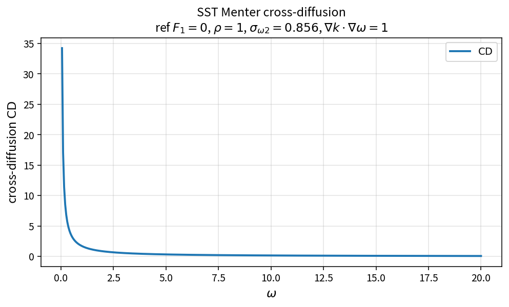

SST Menter cross-diffusion
==========================

Purpose
-------

Evaluate the Menter cross-diffusion term that couples \(k\) and \(\omega\)
gradients in the outer layer.

Formula
-------

.. math::

   \mathrm{CD}
   =
   2(1-F_1)\,\rho\,\sigma_{\omega2}\,
   \frac{\nabla k\cdot\nabla\omega}{\omega}

Source map
----------

* ``SstCrossDiffMenter`` in ``TurbSstPolicy``
* Downstream: ``SstSourceW``, ``SstDiagonalW``
* Tests: ``tests/solver/turb_sst_policy_test.cpp``
* Theory table: ``tools/verification/data/sst_cross_diff_menter_theory.csv``
* Contract Workbench id: ``sst_cross_diff_menter``

What this proves / does not prove
---------------------------------

**Proves:** CD algebra matches the pure API; vanishes at \(F_1=1\).

**Does not prove:** full residual field or blending-function construction.

References
----------

* Menter, Zonal Two Equation \(k\)-\(\omega\) Turbulence Models (1994).
* NASA Turbulence Modeling Resource (SST).
