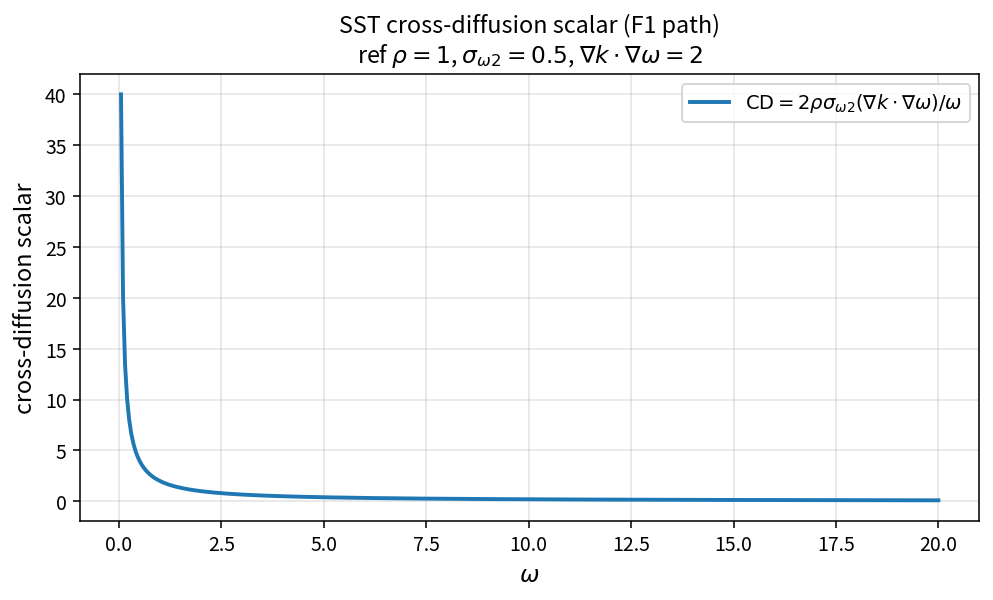

SST cross-diffusion scalar (F1 path)
====================================

Purpose
-------

Evaluate the unblended cross-diffusion scalar used when constructing the SST
\(F_1\) blending argument.

Formula
-------

.. math::

   \mathrm{CD}
   =
   2\rho\sigma_{\omega2}
   \frac{\nabla k\cdot\nabla\omega}{\omega}

Source map
----------

* ``SstCrossDiffScalar`` in ``TurbSstPolicy``
* Downstream: ``SstCdkwWithFloor``, ``SstBlendingArg1``
* Distinct from: ``SstCrossDiffMenter`` (multiplies by \(1-F_1\))
* Tests: ``tests/solver/turb_sst_policy_test.cpp``
* Theory table: ``tools/verification/data/sst_cross_diff_scalar_theory.csv``
* Contract Workbench id: ``sst_cross_diff_scalar``

What this proves / does not prove
---------------------------------

**Proves:** scalar CD algebra matches the pure API.

**Does not prove:** full \(F_1\) field accuracy on a case mesh.

References
----------

* Menter SST \(F_1\) construction; NASA TMR SST.
* Related: :doc:`sst_cdkw_with_floor`, :doc:`sst_blending_arg1`.
