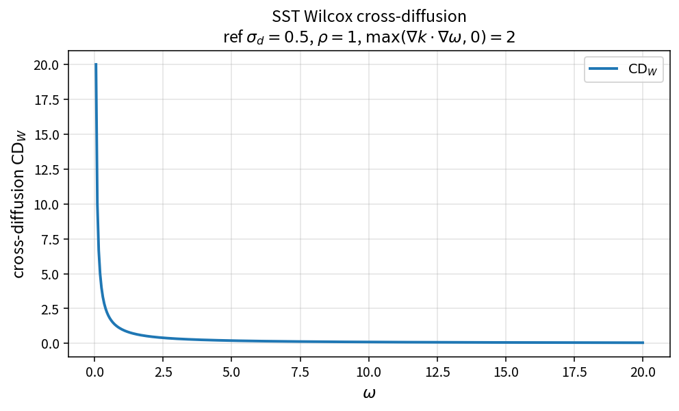

SST Wilcox cross-diffusion
==========================

Purpose
-------

Evaluate the Wilcox-form cross-diffusion contribution to the omega equation.

Formula
-------

.. math::

   \mathrm{CD}_W
   =
   \sigma_d\,\rho\,
   \frac{\max(\nabla k\cdot\nabla\omega,\,0)}{\omega}

Source map
----------

* ``SstCrossDiffWilcox`` in ``TurbSstPolicy``
* Alternate: ``SstCrossDiffMenter``
* Downstream: ``SstSourceW``
* Tests: ``tests/solver/turb_sst_policy_test.cpp``
* Theory table: ``tools/verification/data/sst_cross_diff_wilcox_theory.csv``
* Contract Workbench id: ``sst_cross_diff_wilcox``

What this proves / does not prove
---------------------------------

**Proves:** Wilcox CD algebra and negative-cross clamp match the pure API.

**Does not prove:** full residual field or branch selection vs Menter form.

References
----------

* Wilcox \(k\)-\(\omega\) cross-diffusion; NASA TMR.
* Related: :doc:`sst_cross_diff_menter`.
