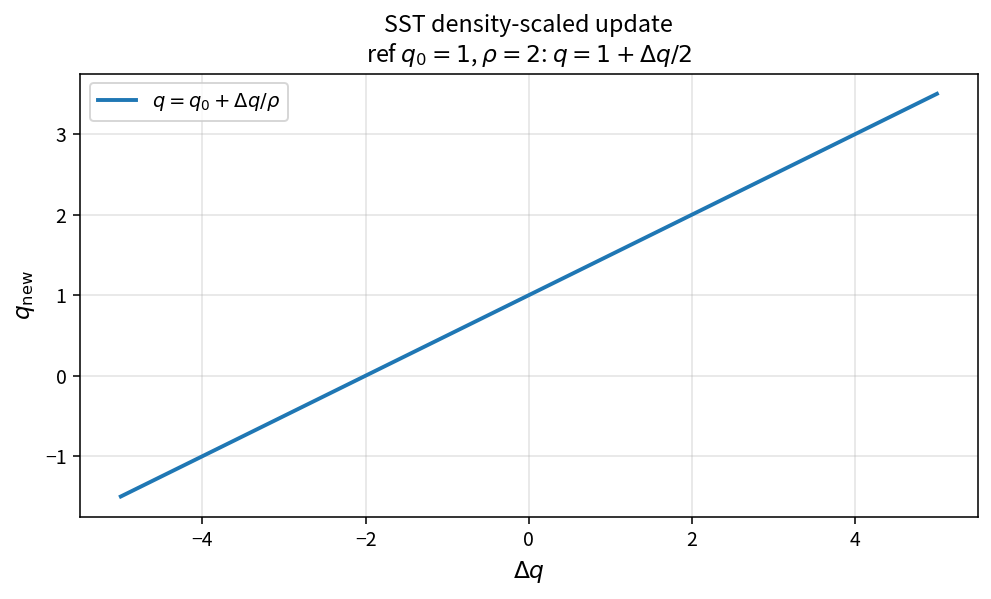

SST density-scaled update
=========================

Purpose
-------

Convert a density-weighted residual increment into a primitive-variable
update for turbulence unknowns.

Formula
-------

.. math::

   q = q_0 + \Delta q/\rho

Source map
----------

* ``SstDensityScaledUpdate`` in ``TurbSstPolicy``
* Downstream floors: ``SstFloorOmega``, ``SstFloorKineticEnergy``
* Tests: ``tests/solver/turb_sst_update_floor_test.cpp``
* Theory table: ``tools/verification/data/sst_density_scaled_update_theory.csv``
* Contract Workbench id: ``sst_density_scaled_update``

What this proves / does not prove
---------------------------------

**Proves:** density-scaled update algebra matches the pure API.

**Does not prove:** full nonlinear update / floor interaction on a case.

References
----------

* SST solver update practice.
* Related: :doc:`sst_floor_omega`.
