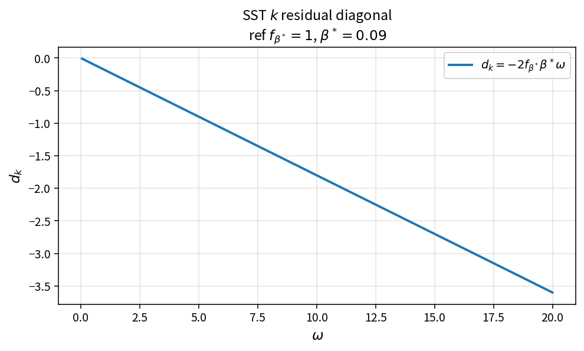

SST k residual diagonal
=======================

Purpose
-------

Evaluate the linearized diagonal contribution of the \(k\) equation used by
implicit residual / LUSGS-style updates.

Formula
-------

.. math::

   d_k = -2\,f_{\beta^*}\,\beta^*\,\omega

Source map
----------

* ``SstDiagonalK`` in ``TurbSstPolicy``
* Tests: ``tests/solver/turb_sst_residual_test.cpp``
* Theory table: ``tools/verification/data/sst_diagonal_k_theory.csv``
* Contract Workbench id: ``sst_residual_diagonal`` (k branch)

What this proves / does not prove
---------------------------------

**Proves:** \(d_k\) algebra matches the pure API on an \(\omega\) grid.

**Does not prove:** full residual Jacobian or omega diagonal branch.

References
----------

* Menter SST linearization practice; NASA TMR SST.
* Related: ``sst_k_source``, ``SstDiagonalW``.
